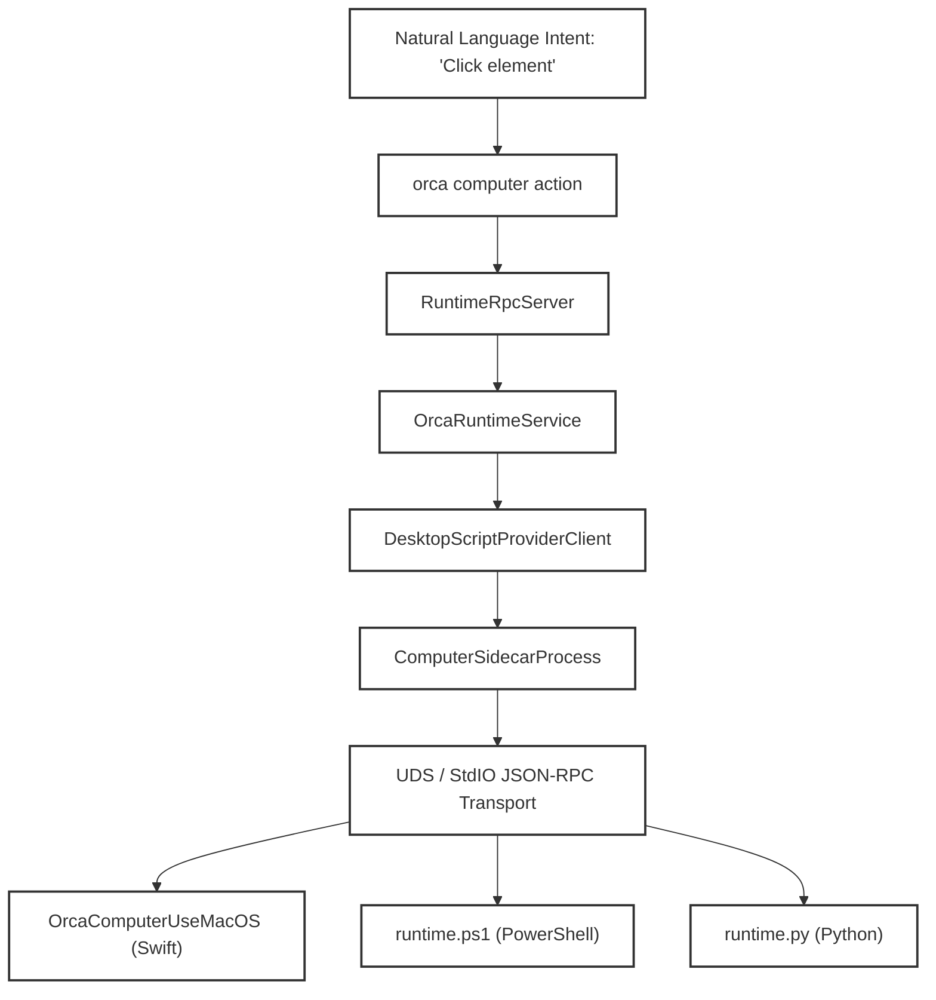
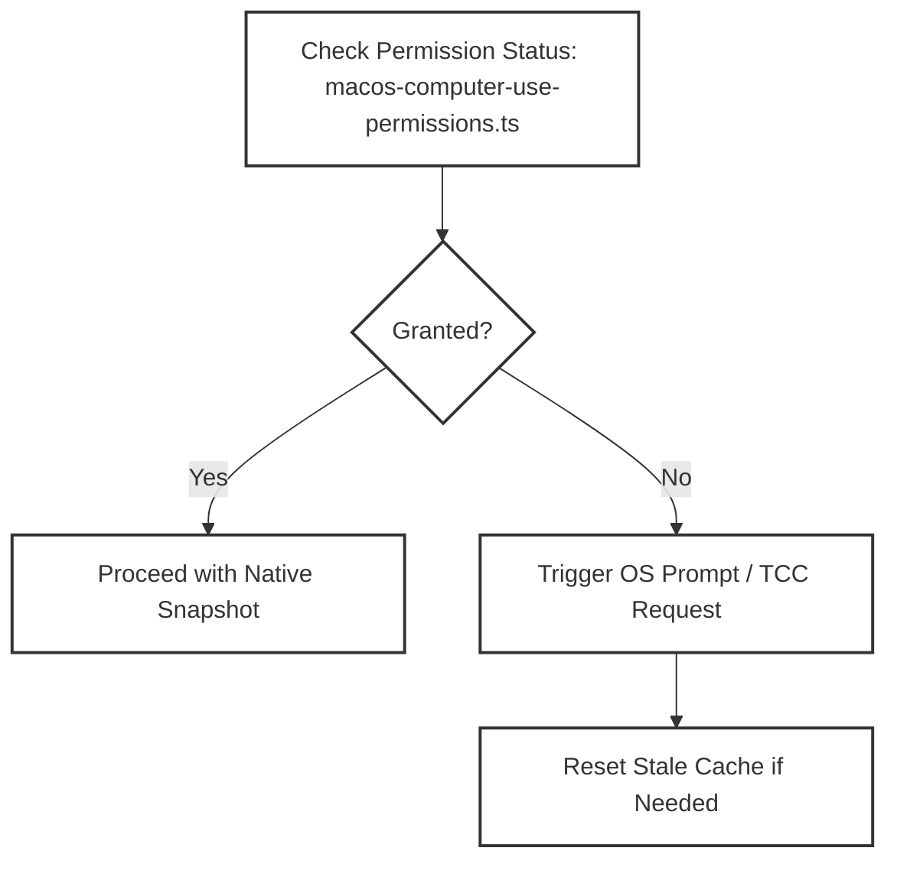

# Computer Use & Desktop Automation

The **Computer Use & Desktop Automation** subsystem provides AI agents and users with the ability to inspect, control, and automate native desktop applications running on the host OS, targeting macOS, Windows, and Linux. It enables traversing accessibility trees of running apps, capturing screenshots, and synthesizing native input events (clicks, keystrokes, scrolls, drags) on arbitrary UI elements, complementing Orca’s internal browser and terminal automation capabilities.

This page documents the architecture, native provider implementations across macOS, Windows, and Linux, transport protocols, permissions management, and integration into AI agent skills.

Sources:
[src/main/computer/desktop-script-provider-client.ts:1-60](),
[src/main/computer/sidecar-client.ts:1-99]()

---

## Architecture & Data Flow

The Computer Use architecture connects AI agents' natural language intents with deep native OS automation through multiple coordinated layers:

- **Natural Language / CLI / Orca Runtime Layer**: Agents express user goals like "click the Send button" which are parsed and routed into automation commands via `RuntimeRpcServer` and `OrcaRuntimeService`.
- **Electron Main Process TypeScript Client (`DesktopScriptProviderClient` & `ComputerSidecarProcess`)**: Responsible for lifecycle management and communication with native provider helpers over Unix Domain Sockets (UDS) or standard I/O [src/main/computer/sidecar-client.ts:123-193](). Exposes core methods such as `listApps()`, `listWindows()`, `snapshot()`, and `action()`.
- **Transport Layer**: A JSON-RPC-like line-delimited protocol over UDS (macOS) or standard I/O (Windows, Linux) connecting the Electron main client to native providers.
- **Native Providers**: Platform-specific executables (`OrcaComputerUseMacOS`, `runtime.ps1`, `runtime.py`) interacting with OS accessibility and input frameworks.
- **Permissions Subsystem**: Manages OS-specific permissions (e.g., macOS Accessibility and Screen Recording) [src/main/computer/macos-computer-use-permissions.ts:1-100]().

### Natural Language to Code Entity Flow

Sources:
[src/main/computer/desktop-script-provider-client.ts:48-60](),
[src/main/computer/sidecar-client.ts:95-99](),
[native/computer-use-macos/Sources/OrcaComputerUseMacOS/main.swift:10-210]()

---

## Native Provider: macOS

The macOS native provider, **`OrcaComputerUseMacOS`**, is a Swift executable communicating over a Unix Domain Socket with the Electron main process client. It leverages macOS's Accessibility API and system frameworks to gather UI state, capture screenshots, and synthesize input.

### Accessibility Tree Traversal

- Recursive inspection of UI elements is performed via the `AXUIElement` API [native/computer-use-macos/Sources/OrcaComputerUseMacOS/main.swift:86-103]().
- The provider builds a `Snapshot` including application metadata (`AppDescriptor`), window titles, screen-space bounds, window `CGWindowID`, and layering.
- Each `ElementRecord` captures a unique index, the `AXUIElement` handle, local frame, supported actions, and an element fingerprint.

### Screenshot Capture

- Uses **`ScreenCaptureKit`** (macOS 12+) or CoreGraphics fallback (`CGWindowListCreateImage`) for screenshots.
- Screenshots are encoded as base64 PNG data with dimensions, scaling factor (`screenshotScale`), and capture engine metadata.

### Input Action Implementation

Supported input actions include `click`, `performSecondaryAction`, `setValue`, `typeText`, `pressKey`, `hotkey`, `scroll`, and `drag`.

Sources:
[native/computer-use-macos/Sources/OrcaComputerUseMacOS/main.swift:130-210]()

---

## Native Provider: Windows

The Windows native provider, **`runtime.ps1`**, is a PowerShell script that communicates with the Electron main process client over standard I/O.

- Uses `UIAutomationClient` to inspect UI elements and construct a JSON UI tree representation [native/computer-use-windows/runtime.ps1:1-100]().
- Utilizes `System.Drawing` for capturing screenshots and Win32 API interop (`SendInput`, `PostMessage`) via dynamic C# compilation (`Add-Type`) for input synthesis [native/computer-use-windows/runtime.ps1:101-217]().

Sources:
[native/computer-use-windows/runtime.ps1:1-217]()

---

## Native Provider: Linux

The Linux native provider, **`runtime.py`**, is a Python script communicating over standard I/O.

- Employs `pyatspi` for AT-SPI accessibility tree traversal [native/computer-use-linux/runtime.py:1-60]().
- Relies on external command-line tools like `gnome-screenshot` or `scrot` for screenshots, and `xdotool` for keyboard and mouse event simulation [native/computer-use-linux/runtime.py:61-100]().

Sources:
[native/computer-use-linux/runtime.py:1-100]()

---

## Permissions Subsystem

To operate correctly on macOS, the native provider requires system permissions managed by the TCC subsystem:
- **Accessibility**: Allows inspecting and interacting with UI elements of other applications via `AXUIElement`.
- **Screen Recording**: Required to capture screenshots of app windows or displays.

Orca provides programmatic state queries, interactive requests, and stale permission cache resets to handle helper binary access recovery [src/main/computer/macos-computer-use-permissions.ts:82-118]().

### Permission State Flow

Sources:
[src/main/computer/macos-computer-use-permissions.ts:1-100](),
[src/main/computer/macos-computer-use-permissions.test.ts:75-95]()

---

## AI Agent Integration: Skills

Computer Use functionality is surfaced to AI agents and the CLI via the **`computer-use` skill**, standardizing discovery (`listApps`, `listWindows`), observation (`getAppState`), and control (`click`, `setValue`, `typeText`, `scroll`, `drag`) [skills/computer-use/SKILL.md:1-46](). The skill definition and bundle manifests are verified against packaged hashes [resources/skills/current-manifest.json:1-18]().

Sources:
[skills/computer-use/SKILL.md:1-46](),
[resources/skills/current-manifest.json:1-18]()

---

## Implementation Details

### TypeScript Client Architecture

- **`ComputerSidecarProcess`** manages the lifecycle of the native provider executable, handling restarts, process health, and JSON-RPC transport over UDS or stdio [src/main/computer/sidecar-client.ts:123-193]().
- **`DesktopScriptProviderClient`** wraps the sidecar process to expose high-level automation methods (`snapshot`, `action`, `listApps`) [src/main/computer/desktop-script-provider-client.ts:48-60]().
- RPC error mapping integrates computer use failures cleanly into the runtime RPC dispatcher error architecture [src/main/runtime/rpc/errors.ts:80-95]().

Sources:
[src/main/computer/desktop-script-provider-client.ts:48-60](),
[src/main/computer/sidecar-client.ts:123-193](),
[src/main/runtime/rpc/errors.ts:80-95]()
