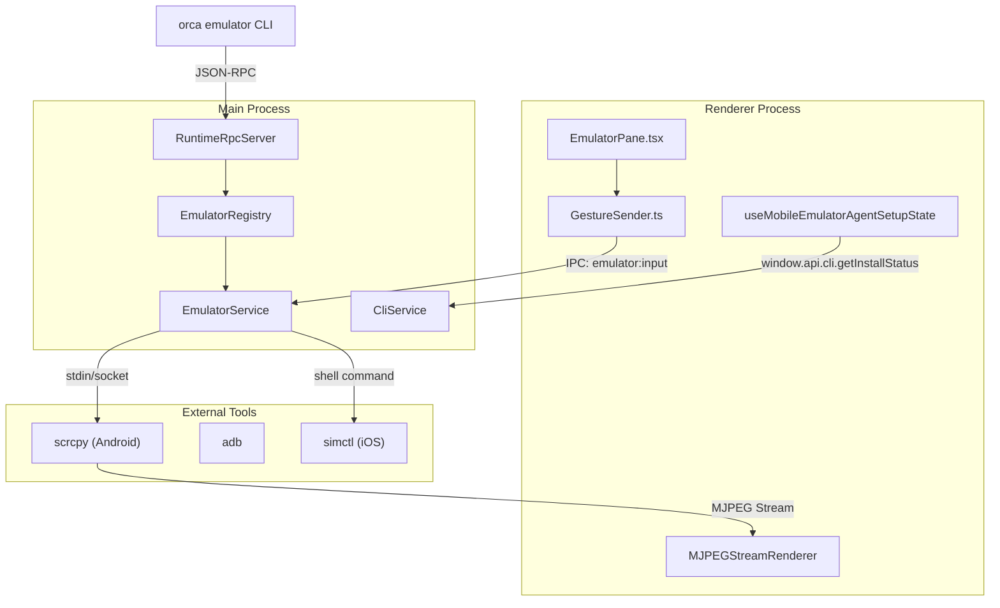
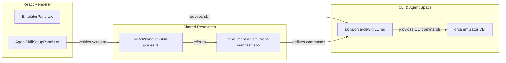

# Mobile Emulator Pane

The **Mobile Emulator Pane** integrates iOS Simulator and Android Emulator functionality into the Orca desktop environment. It enables live video streaming of mobile device screens, gesture and keyboard input injection, session lifecycle management, and AI agent orchestration of mobile devices using CLI commands and skills. This allows users and AI agents to remotely control mobile emulators for testing, automation, and interaction from within Orca.

This page documents the full technical implementation of this subsystem, covering the renderer UI surface that renders video and captures input, the main process registry and service layer that manages emulator sessions and native subprocesses, and the CLI/skill integration that exposes emulator controls to AI agents.

---

## 1. System Architecture Overview

The Mobile Emulator Pane spans multiple process layers coordinating together with native tooling to provide smooth emulation and input handling:

### Renderer Process Components

- **`EmulatorPane.tsx`**
  A React component responsible for rendering the live MJPEG video stream of the emulator screen and capturing user gestures (taps, swipes, typing). It normalizes input coordinates and forwards gestures to the main process via IPC.

- **`GestureSender.ts`**
  A utility abstracting gesture event normalization and sending these events over the IPC `emulator:input` channel to the main process.

- **`MJPEGStreamRenderer`**
  An optimized MJPEG decoder and canvas renderer that displays real-time frames streamed from native emulator tools.

- **`useMobileEmulatorAgentSetupState`**
  A React hook that monitors the installation and versioning state of the native emulator CLI skill, driving UI readiness status and hints.

### Main Process Components

- **`EmulatorRegistry`**
  The core singleton managing active emulator sessions keyed by device identifiers. It spawns native emulator subprocesses (such as `scrcpy` or `simctl`), manages their lifecycle, routes input events from the renderer to platform-specific injection commands, and forwards streamed MJPEG data back to the renderer.

- **`EmulatorService`**
  Abstracts platform-specific details, handling the mechanics of launching native mobile emulator tools, managing subprocess IO streams (video and input), and providing an API for sending emulator control commands.

- **`RuntimeRpcServer`**
  Exposes emulator-related CLI commands over Orca's runtime JSON-RPC [src/main/runtime/rpc/methods/worktree.ts:1-40]() to allow AI agents and CLI clients to control emulator sessions programmatically.

- **`CliService`**
  Implements the `orca emulator` CLI command group as a skill, allowing agents and users to invoke emulator operations such as listing sessions, tapping, swiping, typing, and attaching to devices [src/cli/specs/core.ts:10-40]().

### External Emulator Tools

- **Android**
  - `scrcpy`: Streams device screens over MJPEG via socket and accepts input injection for gestures through TCP/local socket connections.
  - `adb`: Android Debug Bridge to issue shell commands such as input tap/swipe/text for interaction emulation.

- **iOS**
  - `simctl`: The Xcode command-line tool capable of launching/shutting down iOS simulators and injecting input events including simulated touches and keyboard input.

### High-Level Data Flow Diagram (Natural Language to Code Entity Space)

Sources:
`src/renderer/src/components/settings/MobileEmulatorSettingsPane.tsx`(),
`src/renderer/src/components/settings/MobileEmulatorAgentControlRow.tsx`(),
`src/renderer/src/components/emulator-pane/MobileEmulatorAgentSetupGuideSteps.tsx`(),
`src/cli/specs/core.ts:10-40`(),
`src/main/runtime/rpc/methods/worktree.ts:1-40`()

---

## 2. Emulator Registry and Session Management

The **`EmulatorRegistry`** in the main process centrally orchestrates emulator session lifecycles and multiplexes input and output channels.

### Key Responsibilities

- **Session Lifecycle Management**
  Maintains an in-memory map of active emulator sessions keyed by device IDs. Creates sessions on request, shuts down inactive sessions, and manages native subprocess handles. Supports multiple simultaneous emulator instances.

- **Video Stream Forwarding**
  Bridges native MJPEG video streams received from `scrcpy` to renderer IPC subscribers over the `emulator:stream` channel.

- **Input Event Routing & Injection**
  Receives normalized gesture commands from renderer IPC (`emulator:input`), converts them to platform-specific commands:
  - Android: sends `adb shell input` tap/swipe/text commands or forwards input packets over scrcpy socket.
  - iOS: executes `simctl` CLI commands to simulate taps, swipes, and keyboard input.

- **Concurrency and Ownership Locks**
  Implements exclusive input ownership per emulator session, ensuring one controlling user or AI agent at a time to avoid conflicting inputs.

- **Resource Cleanup**
  Detects closed UI tabs or idle sessions and gracefully shuts down native emulator subprocesses, releases IPC resources, and cleans up session state.

### Core Classes

- **`EmulatorRegistry`**
  - Tracks active sessions using an internal session mapping.
  - Public API to create, attach, release, and query sessions.
  - Registers IPC handlers for events and commands.
  - Handles concurrency lock verification before routing input.

- **`EmulatorService`**
  - Platform abstraction spawning and communicating with native tools (`scrcpy` for Android, `simctl` for iOS).
  - Manages subprocess lifecycle and streams (MJPEG video output, input socket).
  - Provides methods to inject tap, swipe, and type events in device coordinates.

Sources:
`src/renderer/src/components/settings/MobileEmulatorSettingsPane.tsx`(),
`src/renderer/src/components/settings/MobileEmulatorAgentControlRow.tsx`(),
`src/renderer/src/components/emulator-pane/MobileEmulatorAgentSetupGuideSteps.tsx`()

---

## 3. AI Agent Interaction via Emulator CLI and Skills

Orca exposes mobile emulation control to AI agents through a dedicated CLI skill, enabling scripted mobile automation.

### Emulator CLI Commands

The `orca emulator` command group is defined within the CLI specifications [src/cli/specs/core.ts:10-40]().

| Command                     | Description                                   |
| :-------------------------- | :-------------------------------------------- |
| `orca emulator list`        | Lists currently active emulator sessions/devices. |
| `orca emulator attach <id>` | Attaches agent input focus to a session/device.     |
| `orca emulator tap <x> <y>` | Sends a tap gesture at normalized coordinates.       |
| `orca emulator swipe ...`   | Sends a swipe gesture with start/end points and timing. |
| `orca emulator type <text>` | Sends text input to the focused emulator.             |

Agents script these commands via the CLI to automate and interact with mobile emulator UIs. The `orca-cli` skill [skills/orca-cli/SKILL.md:1-11]() is the primary interface for agents to interact with Orca's features, including emulator control.

### Emulator Skill Manifest & Versioning

- The skill is defined by the JSON manifest `resources/skills/current-manifest.json` describing commands and version [resources/skills/current-manifest.json:69-100]().
- The `src/cli/bundled-skill-guides.ts` file contains type definitions for `BundledSkillGuideReference` and `BundledSkillGuide`, which are used to manage skill documentation [src/cli/bundled-skill-guides.ts:3-15]().
- The CLI executable is bundled and verified against the release mapping to ensure correctness.
- Renderer UI components verify skill installation via `useMobileEmulatorAgentSetupState` before enabling emulator controls.

### Agent CLI to Runtime Flow Diagram (Code Entity Space)

Sources:
`skills/orca-cli/SKILL.md:1-11`(),
`src/cli/bundled-skill-guides.ts:3-15`(),
`src/cli/specs/core.ts:10-40`(),
`resources/skills/current-manifest.json:69-100`()

---

## 4. UI Implementation: EmulatorPane Component

The user-facing UI component is the `EmulatorPane.tsx` React component within the renderer process.

### Functional Overview

- **Live Screen Display**
  Renders the emulator screen by decoding MJPEG frames received from main process IPC and drawing them on a canvas using the `MJPEGStreamRenderer` component.

- **User Gesture Capture**
  Listens for pointer and touch events on the emulator video area, capturing taps, drags/swipes, and keystrokes. Converts absolute pixel positions to normalized coordinates in `[0.0, 1.0]` relative to the device screen.

- **Sending Gestures**
  Normalized gestures are forwarded to the main process using the `GestureSender` utility via IPC on the `emulator:input` channel.

- **Agent Skill Setup State**
  Uses `useMobileEmulatorAgentSetupState` hook to track CLI and skill installation/versioning status and display hints or badge overlays about readiness.

- **Multi-Session Support**
  Supports switching between multiple connected device sessions, coordinating session state with AI agents and user input.

### Supporting Components and Hooks

- **`GestureSender.ts`**
  Handles normalizing coordinates and sequencing gesture events, dispatching them over IPC.

- **`AgentSkillSetupPanel.tsx`**
  Displays installation, version, and readiness state for emulator CLI and skill binaries, aiding user setup. This component handles the display of installation commands and their execution in an inline terminal [src/renderer/src/components/settings/AgentSkillSetupPanel.tsx:21-50]().

- **`useMobileEmulatorAgentSetupState`**
  React hook that checks skill install/version asynchronously and returns UI consumption state.

Sources:
`src/renderer/src/components/settings/AgentSkillSetupPanel.tsx:21-50`(),
`src/renderer/src/components/settings/MobileEmulatorSettingsPane.tsx`()

---

## 5. Dependency & Versioning Management

Orca’s mobile emulator integration ensures stable and secure operation by tightly controlling skill and CLI versions.

### Mechanisms

- **Bundled Skill Guides**
  The `src/cli/bundled-skill-guides.ts` file defines types for `BundledSkillGuideReference` and `BundledSkillGuide`, which are used to manage skill documentation and ensure version consistency [src/cli/bundled-skill-guides.ts:3-15]().
- **Skill & CLI Installation Checks**
  The UI hook `useMobileEmulatorAgentSetupState` verifies skill presence, CLI binary version, and that agent platforms are supported before enabling emulator features. The `AgentSkillSetupPanel` component uses `isOrcaCliAvailableOnPath` [src/renderer/src/components/settings/AgentSkillSetupPanel.tsx:43]() to check CLI availability.
- **Binary Packaging**
  Bundled native CLI executables and resources are verified during packaging with electron-builder configuration, ensuring shipped apps have correct native tools.

Sources:
`src/cli/bundled-skill-guides.ts:3-15`(),
`src/renderer/src/components/settings/AgentSkillSetupPanel.tsx:43`(),
`resources/skills/current-manifest.json:69-100`()
