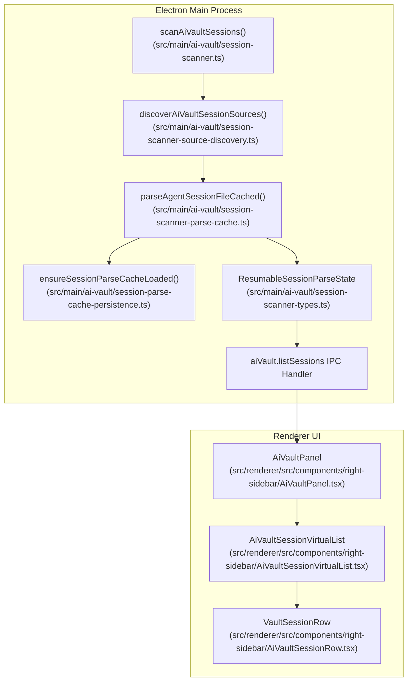
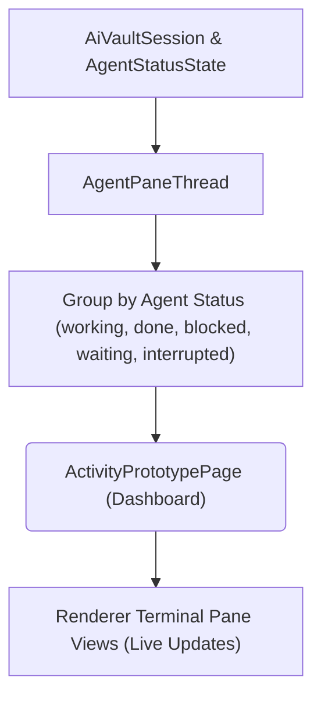
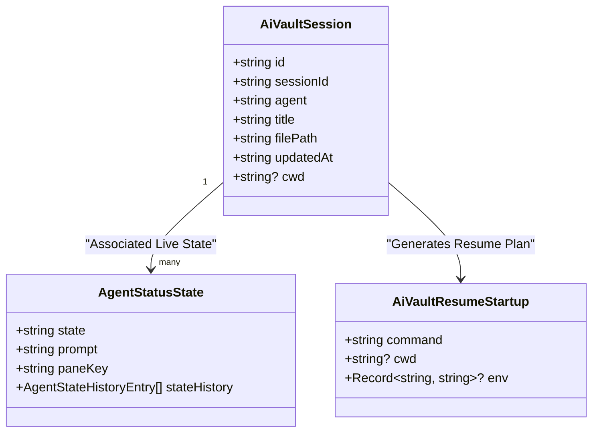
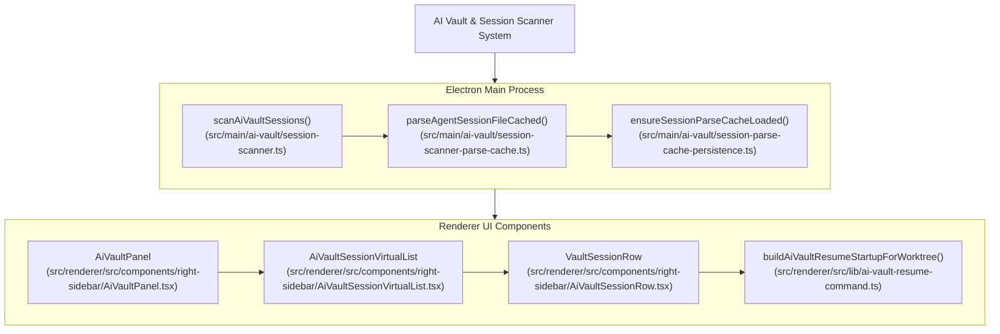

# AI Vault & Session Scanner

The **AI Vault** subsystem in Orca serves as the centralized platform for scanning, parsing, and extracting session data from multiple AI agent products. The subsystem is responsible for consolidating session histories and usage metrics spanning different agent products into a single coherent store. This session data is critical for features like retained agents, session resumption, activity surfaces, and billing or usage analytics.

At its core lies the **Session Scanner**, which runs primarily in the **Electron main process** to leverage native Node.js APIs for efficient file system access and watching. The scanner parses agent-specific session formats, incrementally rescans on file changes, and persists usage state to durable stores. This enables smooth real-time updates of agent activity and session histories surfaced in the UI, particularly the AI Vault Panel and activity dashboards.

---

## Session Scanner Architecture

The session scanner comprises multiple parsers, each tailored to a specific AI agent product session data format. The architecture follows a modular, incremental approach to parsing, persistence, and live updates.

### Supported Agent Session Sources

- **Claude Sessions**
  JSON Lines (JSONL) logs encoding conversation turns, timestamps, prompt/response content, agent metadata, and detailed usage/token counts including tiered pricing ([src/main/ai-vault/session-scanner-primary-parsers.ts]()) [src/main/ai-vault/session-scanner-parse-cache.ts:56-57]().

- **Codex Sessions**
  Multi-lane JSONL session logs representing runtime mirrors, user-managed stores, and ephemeral shared mirrors; deduplicated on import ([src/main/ai-vault/session-scanner-codex-parser.ts]()) [src/main/ai-vault/session-scanner-parse-cache.ts:63-64]().

- **OpenCode Sessions**
  SQLite databases tracking operational token usage metrics, cache hits, spikes, and session events ([src/main/ai-vault/session-scanner-opencode-sqlite.ts]()) [src/main/ai-vault/session-scanner.ts:60-62]().

- **Kimi, Grok, Devin Sessions**
  Custom parsers leveraging agent-specific data formats and indexes ([src/main/ai-vault/session-scanner-devin-db.ts]()) [src/main/ai-vault/session-scanner.ts:44]().

---

### Parsing & Data Flow

Each parser performs the following:

- **Session Discovery:**
  Reads agent-specific base directories or files, watching for file system changes to trigger incremental rescans ([src/main/ai-vault/session-scanner-source-discovery.ts]()) [src/main/ai-vault/session-scanner.ts:91]().

- **Agent-Specific Parsing:**
  Extracts session metadata such as start/end timestamps, session IDs, agent/model names, worktree CWD paths, and token usage breakdowns (e.g., prompt tokens, completion tokens, cache hits, special tiers) ([src/main/ai-vault/session-scanner-types.ts]()) [src/main/ai-vault/session-scanner-types.ts:137-165]().

- **Worktree Attribution:**
  Matches session CWDs against known Orca workspace worktrees to associate usage with local project spaces. This is handled by functions like `resolveAiVaultSessionWorktreeInfo` and `useAiVaultSessionWorktreeMap`. The `useAiVaultSessionWorktreeMap` hook builds a map of session IDs to `AiVaultSessionWorktreeInfo` objects, which include the worktree status, label, path, and ID.

- **Incremental Persistence:**
  Maintains per-session state with modification timestamps to avoid redundant parsing ([src/main/ai-vault/session-scanner-parse-cache.ts]()) [src/main/ai-vault/session-scanner-parse-cache.ts:124-126](). Caches parsed structures via `ensureSessionParseCacheLoaded` and `scheduleSessionParseCachePersist` [src/main/ai-vault/session-scanner.ts:90]().

- **Update Broadcasting:**
  Exposes parsed session data in-memory for the renderer UI via IPC, feeding the AI Vault Panel and associated activity surfaces ([src/main/ai-vault/session-scanner.ts]()) [src/main/ai-vault/session-scanner.ts:143-146]().

---

### Session Scanner Sequence Overview

Sources:
[src/main/ai-vault/session-scanner.ts](),
[src/main/ai-vault/session-scanner-parse-cache.ts](),
[src/main/ai-vault/session-scanner-types.ts](),
[src/renderer/src/components/right-sidebar/AiVaultPanel.tsx](),
[src/renderer/src/components/right-sidebar/AiVaultSessionVirtualList.tsx](),
[src/renderer/src/components/right-sidebar/AiVaultSessionRow.tsx]()

---

## AI Vault Panel & Activity Surfaces

The **AI Vault Panel** is implemented in the renderer ([src/renderer/src/components/right-sidebar/AiVaultPanel.tsx]()) as a React component. It provides users a comprehensive interface to explore session histories parsed by the Session Scanner.

### Key Features

- **Filtering and Grouping:**
  Sessions can be filtered by worktree scope (`AiVaultScope`), host environment (`ExecutionHostScope`), and agent. The `AiVaultPanel` manages the `scope` state [src/renderer/src/components/right-sidebar/AiVaultPanel.tsx:109-112]() and `executionHostScope` [src/renderer/src/components/right-sidebar/AiVaultPanel.tsx:88-89](). The `VaultScopeSwitch` component allows users to change the scope.

- **Virtualized List Rendering:**
  Efficiently renders thousands of sessions using the virtualized list component `AiVaultSessionVirtualList` [src/renderer/src/components/right-sidebar/AiVaultSessionVirtualList.tsx:30-94](). This component uses `@tanstack/react-virtual` to manage virtualized rows, estimating row sizes based on whether a session is expanded or not [src/renderer/src/components/right-sidebar/AiVaultSessionVirtualList.tsx:118-129]().

- **Session Resumption:**
  Supports drag-drop or click resume actions that recreate an AI agent session in a terminal tab using exact environment and command-line arguments. The `VaultSessionRow` component handles drag-and-drop for session resumption [src/renderer/src/components/right-sidebar/AiVaultSessionRow.tsx:115-142](). Resume actions are resolved by `useAiVaultPanelSessionResume` [src/renderer/src/components/right-sidebar/AiVaultPanel.tsx:153-166]() and `useAiVaultSessionLaunchActions` [src/renderer/src/components/right-sidebar/AiVaultPanel.tsx:23]().

- **Session Details:**
  Session rows expand to show conversation excerpts, agent state history, and live updates from hooks via `VaultSessionRow` [src/renderer/src/components/right-sidebar/AiVaultSessionRow.tsx:32-93](). The `SessionInlineDetails` component renders the expanded details of a session [src/renderer/src/components/right-sidebar/AiVaultSessionDetails.tsx:32-59]().

- **Continuation Dialog:**
  Allows branching from an existing session with choice of continuation mode and target worktree. The `AgentSessionContinuationDialog` is used for this purpose [src/renderer/src/components/right-sidebar/AiVaultPanel.tsx:42]().

Sources:
[src/renderer/src/components/right-sidebar/AiVaultPanel.tsx](),
[src/renderer/src/components/right-sidebar/AiVaultSessionVirtualList.tsx](),
[src/renderer/src/components/right-sidebar/AiVaultSessionRow.tsx](),
[src/renderer/src/components/right-sidebar/AiVaultSessionDetails.tsx](),
[src/renderer/src/components/right-sidebar/ai-vault-session-launch-actions.ts]()

---

### Aggregated Activity Dashboard

The AI Vault subsystem feeds into an **Activity Dashboard** (`ActivityPrototypePage`) that aggregates live agent statuses and historical usage events, grouping activity by terminal pane keys and session threads to display real-time and historic AI activity states such as `working`, `waiting`, `blocked`, and `done`.

Sources:
[src/renderer/src/components/right-sidebar/AiVaultSessionRow.tsx](),
[src/renderer/src/components/right-sidebar/ai-vault-session-row-display.tsx]()

---

## Session Resumption and Context Object

Session resumption creates an **AiVaultResumeStartup** object encapsulating:

- Exact command line and environment variables used to launch the agent session ([src/renderer/src/lib/ai-vault-resume-command.ts]()) [src/renderer/src/lib/ai-vault-resume-command.ts:39-46]().
- Execution host context information (local, WSL, or SSH).
- Optional environment variables for removal to maintain a clean environment (`realHomeCodexResumeEnvDeletion`) [src/renderer/src/lib/ai-vault-resume-command.ts:142-143]().

This object is produced in the AI Vault components (`buildAiVaultResumeStartupForWorktree`) and consumed by terminal tabs to restore precisely the prior agent session context [src/renderer/src/lib/ai-vault-resume-command.ts:79-81](). The `buildResumeStartup` function in `useAiVaultSessionLaunchActions` is responsible for creating this object [src/renderer/src/components/right-sidebar/ai-vault-session-launch-actions.ts:70-77]().

Sources:
[src/renderer/src/lib/ai-vault-resume-command.ts](),
[src/renderer/src/components/right-sidebar/ai-vault-session-launch-actions.ts]()

---

## Metadata & Live State Correlation

Orca links static historical session data (`AiVaultSession`) with live ephemeral agent states (`AgentStatusState`) and aggregated usage stats, enabling a rich, multi-faceted view combining logs with real-time state:

The `VaultSessionRow` component receives `liveState: AgentStatusState | null` as a prop to display the live status of an agent session [src/renderer/src/components/right-sidebar/AiVaultSessionRow.tsx:34](). The `SessionMetadata` component uses this `liveState` to render status details [src/renderer/src/components/right-sidebar/ai-vault-session-row-display.tsx:25-27]().

Sources:
[src/renderer/src/components/right-sidebar/AiVaultSessionRow.tsx](),
[src/renderer/src/components/right-sidebar/ai-vault-session-row-display.tsx](),
[src/shared/ai-vault-types.ts]()

---

## Incremental Scanning & Persistence

The Session Scanner maintains file modification times and hashes for sessions to enable incremental updates via `parseAgentSessionFileCached` [src/main/ai-vault/session-scanner-parse-cache.ts:124-126](). This is critical for performance when scanning large session histories, avoiding unnecessary re-parsing.

Persistence uses debounced atomic writes through cache store routines like `storeSessionParseCacheEntry` and `snapshotSessionParseCacheForPersistence` to reduce disk overhead [src/main/ai-vault/session-parse-cache-store.ts:21-22,33-34]().

Sources:
[src/main/ai-vault/session-scanner-parse-cache.ts](),
[src/main/ai-vault/session-scanner.ts](),
[src/main/ai-vault/session-parse-cache-store.ts]()

---

## Summary Diagram: High-Level System to Code Entities

Sources:
[src/main/ai-vault/session-scanner.ts](),
[src/main/ai-vault/session-scanner-parse-cache.ts](),
[src/renderer/src/components/right-sidebar/AiVaultPanel.tsx](),
[src/renderer/src/components/right-sidebar/AiVaultSessionVirtualList.tsx](),
[src/renderer/src/components/right-sidebar/AiVaultSessionRow.tsx](),
[src/renderer/src/lib/ai-vault-resume-command.ts]()

---

## References and Source Files

- Main Session Scanner entrypoint and orchestration:
  [src/main/ai-vault/session-scanner.ts:56-145]()

- Session parse cache and incremental state management:
  [src/main/ai-vault/session-scanner-parse-cache.ts:124-126]()

- Session scanner types and accumulator definitions:
  [src/main/ai-vault/session-scanner-types.ts:15-67]()

- Shared AI Vault type definitions and validation:
  [src/shared/ai-vault-types.ts:94-137]()

- AI Vault React UI panel root component:
  [src/renderer/src/components/right-sidebar/AiVaultPanel.tsx:49-171]()

- Virtualized session list component:
  [src/renderer/src/components/right-sidebar/AiVaultSessionVirtualList.tsx:30-94]()

- Individual session row rendering and context menu actions:
  [src/renderer/src/components/right-sidebar/AiVaultSessionRow.tsx:32-93]()

- Resume startup and environment command builder:
  [src/renderer/src/lib/ai-vault-resume-command.ts:66-120]()

---

This page documents the Orca AI Vault & Session Scanner subsystem, detailing how it integrates multiple AI agent session formats with real-time agent activity detection to surface a unified developer experience centered on rich AI session histories, usage tracking, and live resumption capabilities.

Sources:
[src/main/ai-vault/session-scanner.ts](),
[src/main/ai-vault/session-scanner-parse-cache.ts](),
[src/main/ai-vault/session-scanner-types.ts](),
[src/shared/ai-vault-types.ts](),
[src/renderer/src/components/right-sidebar/AiVaultPanel.tsx](),
[src/renderer/src/components/right-sidebar/AiVaultSessionVirtualList.tsx](),
[src/renderer/src/components/right-sidebar/AiVaultSessionRow.tsx](),
[src/renderer/src/lib/ai-vault-resume-command.ts]()
