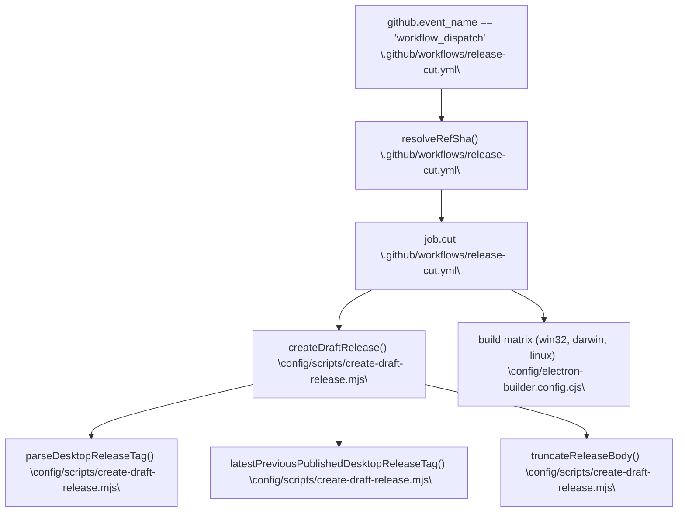
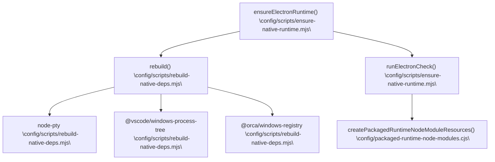

# Build, Packaging & Release

This page provides a high-level overview of how Orca's source code is built, packaged, and released as production-ready applications. It focuses on packaging configurations using `electron-builder`, platform-specific build/signing/notarization requirements, native dependency management, and GitHub Actions pipelines for continuous integration and release control. For detailed technical implementation and workflows, see the linked child pages.

---

## Packaging Configuration

Orca uses [electron-builder](https://www.electron.build/) as its core packaging tool to produce distributable applications for Windows, macOS, and Linux. The main packaging configuration resides in the `config/electron-builder.config.cjs` file. This file defines packaging policies, platform-specific resource inclusions, file exclusions, native binary handling, and post-package validation steps to produce clean, optimized builds [config/electron-builder.config.cjs:1-154]().

### Key Packaging Details

- **ASAR Packaging:**
  Most runtime code and resources are bundled inside an ASAR archive (`app.asar`) to improve loading performance and integrity. Certain runtime-critical resources and executables are left unpacked outside the archive to allow native execution or interprocess invocation without extraction overhead:
  - CLI executables (`out/cli/**`)
  - Shared runtime modules (`out/shared/**`)
  - Daemon entrypoints and parcel watcher processes
  - Native binary resources (e.g., speech model addons, platform helpers)
  These unpacked components reside under `extraResources` to ensure they are physically present on the filesystem [config/electron-builder.config.cjs:108-154]().

- **Development Source Exclusion:**
  To minimize package size and avoid shipping development-only artifacts, source directories (`src/`, `config/`, `mobile/`, `native/`), tests, examples, skill guides, and markdown documentation are excluded from the packaged ASAR [config/scripts/electron-builder-config.test.mjs:25-44](). Cached Electron development bundles are also excluded [config/scripts/electron-builder-config.test.mjs:148-163]().

- **Extra Resources:**
  Certain runtime assets that cannot be packed into ASAR archives are included as raw, accessible files:
  - SSH relay binaries (`out/relay`)
  - Bundled plugin directories (`resources/plugins/launch`)
  - Skill freshness manifests (`resources/skills`)
  - Native platform helper executables [config/electron-builder.config.cjs:108-154]().

### Platform Packaging Formats

| Platform | Output Format | Notes |
|---|---|---|
| Windows | NSIS installer (`orca-windows-setup.exe`) | Includes Windows-specific native bits and CLI tools; signed via SignPath [config/scripts/electron-builder-config.test.mjs:137-147]() |
| macOS | DMG or ZIP supporting x64 & arm64 | Hardened runtime enabled, notarization enforced, including proper code signing of helper binaries [config/electron-builder.config.cjs:65-80]() |
| Linux | AppImage, DEB, RPM | Standard Linux packaging with Electron's loader requirements and Orca's headless-host dependencies [config/electron-builder.config.cjs:122-144]() |

Sources: [config/electron-builder.config.cjs:1-154](), [config/scripts/electron-builder-config.test.mjs:25-44](), [config/scripts/electron-builder-config.test.mjs:148-163]()

---

## macOS Hardened Runtime & Notarization

macOS builds use Apple’s Hardened Runtime security framework and require notarization to avoid system warnings and enable automated updates. These are applied selectively on release builds with environment flags `ORCA_MAC_RELEASE`, `ORCA_MAC_HOURLY`, and `ORCA_MAC_ADHOC` controlling build channel identity [config/electron-builder.config.cjs:65-80]().

### Notable Platform-Specific Details

- **Code Signing & Entitlements:**
  The core app and helper executables are signed with dedicated entitlements from `entitlements.mac.plist` adjusted for hardened runtime restrictions. Particular helper apps such as "Orca Computer Use.app" and notification status helpers have their own signing to satisfy macOS security [config/scripts/electron-builder-config.test.mjs:122-128]().

- **Helper Binary Placement:**
  The notification status helper binary is installed under `Contents/MacOS` rather than `Contents/Resources` to work around macOS crashing behaviors with notification centers [config/scripts/electron-builder-config.test.mjs:122-128]().

Sources: [config/electron-builder.config.cjs:65-80](), [config/scripts/electron-builder-config.test.mjs:122-128]()

---

## Release Pipeline

Orca's release is orchestrated by GitHub Actions workflows, automating version calculation, tagging, cross-platform builds, signing, notarization, and package publishing. The primary workflow is `.github/workflows/release-cut.yml` [`.github/workflows/release-cut.yml:1-2570`](), working alongside release script modules like `config/scripts/create-draft-release.mjs` [config/scripts/create-draft-release.mjs:115-205]().

### Diagram: Release Cut Architecture (Code Entity Space)

Sources: [`.github/workflows/release-cut.yml:1-2570`](), [config/scripts/create-draft-release.mjs:115-205]()

### Release Flow Summary

1.  **Version Determination and Validation:**
    The workflow resolves the Git reference to a commit SHA and fetches the latest stable release tag. Using semantic versioning via `parseDesktopReleaseTag` [config/scripts/create-draft-release.mjs:12-24](), it determines the next release version based on input kinds (`rc`, `patch`, `minor`, `major`) [`.github/workflows/release-cut.yml:21-34]() without version regressions.

2.  **Committing and Tagging:**
    If the starting reference is the tip of `main`, the workflow commits the version bump and fast-forwards `main`, pushing annotated tags [`.github/workflows/release-cut.yml:156-159`]().

3.  **Concurrent Platform Builds & Publishing:**
    Platform-specific builds run concurrently for Windows (NSIS), macOS (x64 and arm64), and Linux. Windows builds integrate SignPath code signing, and macOS builds execute hardened runtime signing and notarization [config/electron-builder.config.cjs:65-80]().

Sources: [`.github/workflows/release-cut.yml:1-2570`](), [config/scripts/create-draft-release.mjs:115-205]()

---

## Native Dependency Management

Orca uses native modules such as `node-pty` and platform-specific helpers that require ABI-compatible builds for the Electron runtime.

### Diagram: Native Runtime & Rebuild Flow (Code Entity Space)

Sources: [config/scripts/rebuild-native-deps.mjs:1-169](), [config/scripts/ensure-native-runtime.mjs:1-49](), [config/packaged-runtime-node-modules.cjs:1-210]()

-   **Rebuild Script:**
    `config/scripts/rebuild-native-deps.mjs` runs post-install and prior to packaging to rebuild native modules against Electron's Node ABI while skipping problematic optional modules like `cpu-features` [config/scripts/rebuild-native-deps.mjs:1-169]().

-   **Runtime Validation:**
    `config/scripts/ensure-native-runtime.mjs` verifies native module presence and integrity before launching or packing [config/scripts/ensure-native-runtime.mjs:1-49]().

-   **Package Pruning:**
    `config/packaged-runtime-node-modules.cjs` retains only native binaries matching the target platform and architecture [config/packaged-runtime-node-modules.cjs:199-203]().

Sources: [config/scripts/rebuild-native-deps.mjs:1-169](), [config/scripts/ensure-native-runtime.mjs:1-49](), [config/packaged-runtime-node-modules.cjs:1-210]()

---

## Release Channel Controls

Orca supports multiple release channels with distinct versioning, artifact repositories, and build identity usage:

-   **Shared macOS Identity for Dev Channels:**
    macOS dev builds (hourly/daily/adhoc) share the same app bundle ID and signing credentials as stable releases, enabling seamless update roll-forward via Squirrel.Mac [config/electron-builder.config.cjs:65-80]().

-   **Environment Variables as Feature Gates:**
    Environment switches govern version suffixes, package repository selection, and platform-specific signing behaviors. For instance, `ORCA_BUILD_IDENTITY` and `ORCA_POSTHOG_WRITE_KEY` gate official telemetry and build identifiers [electron.vite.config.ts:53-62]().

Sources: [config/electron-builder.config.cjs:65-80](), [electron.vite.config.ts:53-62]()

---

## Related Child Pages

-   **[CI/CD & Testing](#9.1)** — GitHub Actions workflows (PR validation, release matrices, E2E suites, sharding/routing), unit test strategy, Playwright harnesses, perf/load scenarios.
-   **[Agent Skills & AI Coding Guidelines](#9.2)** — skills/, skill-guides/, skill-stubs/ and resources/skills: how skills guide AI agents, repo conventions (AGENTS.md/CLAUDE.md), bundled skill guidance generation/validation, code-quality lint ratchets.
-   **[Diagnostics, Telemetry & Reliability Gates](#9.3)** — Telemetry events and validator, onboarding telemetry and nags, crash reporting/breadcrumbs, reliability gates and operational safety checks.
-   **[Documentation Site & Assets](#9.4)** — docs/ tree: docs/site Next.js documentation website (content, versioning, deploy), multilingual READMEs, reference docs, generated README badges.
