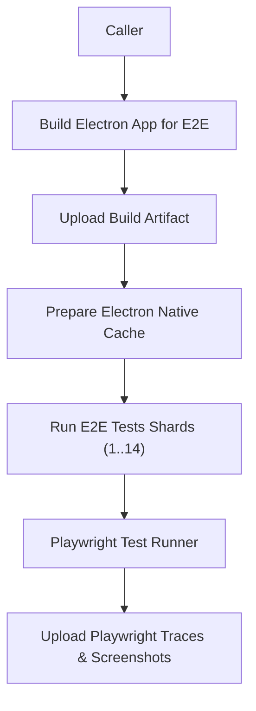
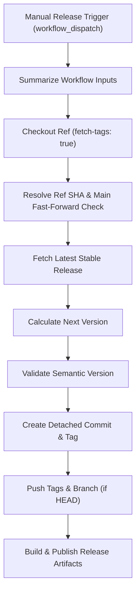
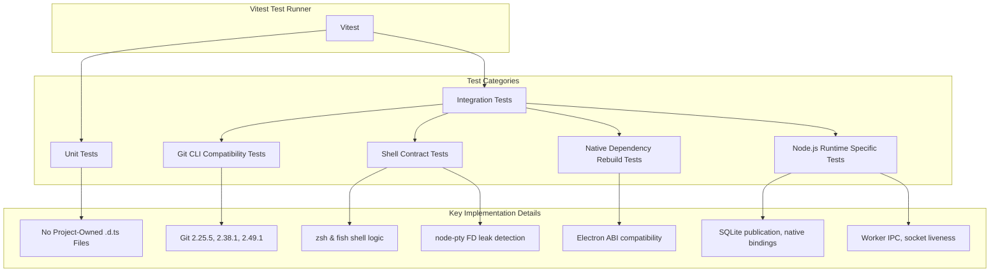
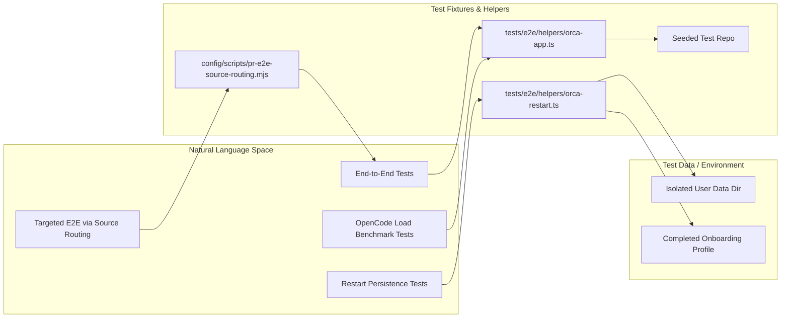
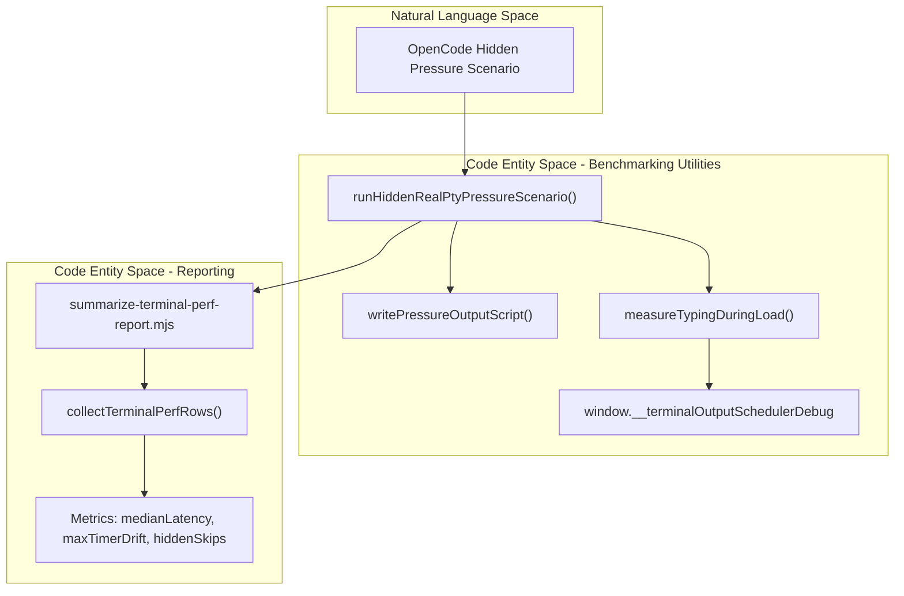
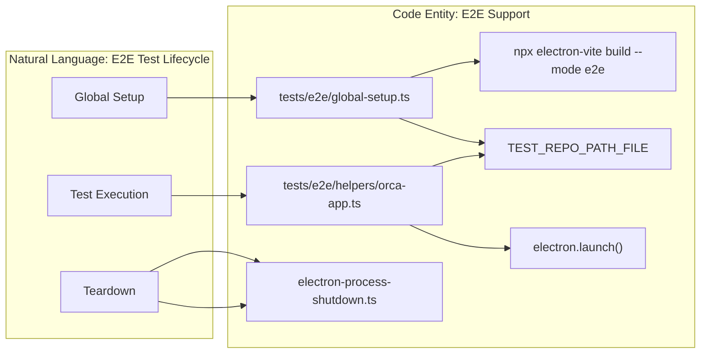

# CI/CD & Testing

This page details the automated workflows, testing strategies, and code quality toolchain used in Orca. The project emphasizes a robust CI/CD pipeline to handle the complexities of a multi-platform Electron application, including native module builds, PTY persistence testing, terminal performance benchmarking, and cross-process end-to-end (E2E) verification.

---

## CI/CD Workflows

Orca utilizes GitHub Actions for continuous integration and automated releases. The workflows are divided into PR validation, E2E sharding, and production release pipelines.

### PR Validation (`pr.yml`)

The PR validation workflow triggers on pull request events (`opened`, `synchronize`, `reopened`, and `ready_for_review`) and runs on an `ubuntu-latest` runner to produce incremental validation results. Key features include:

- **Code Paths Detection**: A preliminary job (`code_paths`) detects which parts of the codebase have changed by comparing the PR's base and head SHAs. It outputs boolean flags to selectively run expensive jobs depending on actual code impact. [config/scripts/pr-code-change-scope.mjs:20-33]()

- **Source Checkout**: Uses `actions/checkout@v6` with `fetch-depth: 50` and `filter: blob:none` filtering to optimize fetch size while preserving enough git history needed for diff generation. [.github/workflows/pr.yml:60-68]()

- **Root Directory Guards**: Checks for and rejects new root-level files and folders to maintain repository hygiene. [.github/workflows/pr.yml:90-95]()

- **README Local Links Check**: Validates local links within README files. [.github/workflows/pr.yml:97-99]()

- **Readiness Check Reuse**: Identifies identical successful required checks to avoid re-running them, especially on `ready_for_review` events. [.github/workflows/pr.yml:109-116]()

- **Node Dependencies Install**: A custom action installs node dependencies, including rebuilding native dependencies such as `node-pty` using Electron-compatible ABI targets. [.github/actions/install-node-dependencies/action.yml:1-25]()

- **Static Analysis**: Runs `pnpm exec oxlint` for fast Oxc-based linting with GitHub annotations. [.github/workflows/pr.yml:134]()

- **Code Quality Audits**: Enforces native and type-aware plugin audits using commands like `pnpm run audit:code-quality:native` and `pnpm run audit:code-quality:type-aware`. [config/scripts/check-changed-code-quality.mjs:16-51]()

- **Changed-Code Quality Checks**: Runs targeted linting and React Doctor on only the changed lines of code for faster feedback. [config/scripts/check-changed-code-quality.mjs:46-51]()

- **Zustand Selector Fan-Out Check**: Prevents excessive cross-slice re-renders in React state stores with `pnpm run check:zustand-selector-fanout`.

- **Reliability Gates**: Validates the reliability gate manifest (`config/reliability-gates.jsonc`) with `pnpm run check:reliability-gates`. [config/reliability-gates.jsonc:1-11]()

- **Max Lines Ratchet**: Ensures code files do not grow beyond configured ratcheted line counts.

- **Skill and Localization Verification**: Validates skill bundles and localization catalogs and coverage.

- **Preload/Shared `.d.ts` Guard**: Disallows project-owned `.d.ts` files under critical directories (`src/preload`, `src/shared`) to avoid silent typecheck bypasses.

- **Feature Wall Asset Budget Check**: Ensures feature-wall frontend assets remain within size budgets.

- **macOS Entitlements Verification**: Checks code signing entitlements on macOS.

- **Typecheck Job**: Runs full TypeScript type checking with `tsc` without emit.

- **Git Compatibility Job**: Builds and tests multiple Git CLI versions, including a source tarball build of v2.25.5 and Docker containers for v2.38.1 and v2.49.1.

- **Shell Contracts Job**: Tests real shell contract fidelity using `zsh` and `fish` logic. Installs these shells on Ubuntu runners and exercises PTY integration and shell environment validation. [config/scripts/pr-workflow-parallelism.test.mjs:24-30]()

- **Unit Tests / Matrix Tests**: Runs Vitest-based unit and integration tests across Node.js versions 24 and 26 and shards the test suite to parallelize execution. [config/scripts/pr-workflow-parallelism.test.mjs:74-80]()

The workflow uses concurrency group cancellation keyed by the PR number to cancel duplicated jobs in progress on updates. [.github/workflows/pr.yml:11-14]()

```mermaid
flowchart TD
    PR["Pull Request Event"] --> Checkout
    Checkout --> RootGuards["Reject new root-level files"]
    RootGuards --> ReadmeLinks["Check README local links"]
    ReadmeLinks --> Readiness["Find identical successful required checks"]
    Readiness --> ClassifyPaths["Classify changed paths"]
    ClassifyPaths --> FilterE2E["Filter changed E2E specs"]
    FilterE2E --> InstallDeps["Install Node Dependencies"]
    InstallDeps --> Lint["Run Oxc Lint"]
    Lint --> CodeQualityNative["Audit: Native Plugins"]
    CodeQualityNative --> CodeQualityTypeAware["Audit: Type-aware Plugins"]
    CodeQualityTypeAware --> ChangedCodeCheck["Changed-Code Quality Checks"]
    ChangedCodeCheck --> ReactDoctor["React Doctor on Changed Lines"]
    ReactDoctor --> ZustandFanOutCheck["Zustand Selector Fan-Out Check"]
    ZustandFanOutCheck --> ReliabilityGatesCheck["Reliability Gate Manifest Check"]
    ReliabilityGatesCheck --> MaxLinesRatchet["Max Lines Ratchet"]
    MaxLinesRatchet --> SkillVerification["Skill Guides and Manifest Verification"]
    SkillVerification --> LocalizationChecks["Localization Catalog and Extraction Checks"]
    LocalizationChecks --> DtsGuard["Preload/Shared .d.ts Guard"]
    DtsGuard --> FeatureWallBudget["Feature Wall Asset Budget Check"]
    FeatureWallBudget --> MacOSEntitlements["Verify macOS Entitlements"]
    MacOSEntitlements --> Typecheck
    Typecheck --> GitCompatibility["Git Binary Compatibility Job"]
    GitCompatibility --> ShellContracts["Shell Contracts Job"]
    ShellContracts --> UnitTests["Unit Tests / Matrix"]
```

Sources: [.github/workflows/pr.yml:1-131](), [config/scripts/pr-code-change-scope.mjs:20-33](), [config/scripts/pr-workflow-parallelism.test.mjs:74-80](), [config/scripts/pr-workflow-parallelism.test.mjs:24-30](), [config/reliability-gates.jsonc:1-11](), [config/scripts/check-changed-code-quality.mjs:16-51]()

---

### End-to-End (E2E) Testing (`e2e.yml`)

The E2E workflow is a reusable GitHub Actions workflow triggered via workflow calls, manual dispatch, or schedule. Its key functions:

- **Build Step**: Builds the Electron app in E2E mode with debug hooks enabled and the global store exposed (`VITE_EXPOSE_STORE: 'true'`). Also builds relay and web renderer bundles. [.github/workflows/e2e.yml:107-109]()

- **Native Build Tools**: Installs system packages (e.g., `build-essential`, `python3`) to support native module compilation and headless graphical apps. [.github/workflows/e2e.yml:65-87]()

- **Node-Gyp Override**: On Linux runners, installs `node-gyp@11.5.0` to override pnpm’s bundled broken version and prevent native rebuild errors. [config/scripts/golden-e2e-experiment.yml:50-56]()

- **Test Sharding**: Splits the Playwright test suite into 14 logical shards, running each shard in parallel to reduce test time. Each shard runs tests under `xvfb-run` (a virtual X server) to enable headless Electron usage. [.github/workflows/e2e.yml:172-183]()

- **Artifacts**: Uploads built artifacts after the build and test results (such as Playwright traces and screenshots on failure) for CI debugging. [.github/workflows/e2e.yml:137-147]()

- **Changed Specs Optimization**: Supports a separate job `e2e_filter` in `pr.yml` to run only those end-to-end specs changed in a PR. [.github/workflows/pr.yml:54-56]()

Sources: [.github/workflows/e2e.yml:1-183](), [.github/workflows/pr.yml:54-56](), [config/scripts/golden-e2e-experiment.yml:50-56]()

---

### Release Pipeline (`release-cut.yml`)

The release pipeline facilitates manual release creation with strict semantic version enforcement to avoid downgrades or electron-updater regressions. The main phases include:

- **Summarize Workflow Inputs**: Logs all `workflow_dispatch` inputs for auditability. [.github/workflows/release-cut.yml:83-103]()

- **Checkout Ref**: Checks out the specified Git reference, fetching all tags to recover unpublished tags. [.github/workflows/release-cut.yml:105-113]()

- **Resolve Git Ref SHA**: Determine the exact commit SHA from the provided release ref input for reproducible builds and identifies if `main` should be fast-forwarded. [.github/workflows/release-cut.yml:125-152]()

- **Fetch Latest Stable Release**: Get latest GitHub release info to compare versions.

- **Calculate Next Version**: Compute the next semantic version from the provided increment type (`rc`, `patch`, `minor`, `major`).

- **Validate Version**: Check that the new version is strictly greater than the previous to prevent regressions.

- **Create Detached Commit & Tag**: Commit the version bump on a detached HEAD and tag the commit.

- **Push Tags & Branch**: Push the tags and update the main branch if the ref matches head.

- **Build & Publish Release Artifacts**: Perform final build steps and publish to release channels.

Sources: [.github/workflows/release-cut.yml:1-161](), [config/scripts/release-cut-token-permissions.test.mjs]()

---

## Testing Infrastructure

### Vitest Unit and Integration Testing

Orca uses Vitest as the primary test runner for unit and integration tests executed under Node.js environments.

#### Key Implementation Details

- **No Project-Owned `.d.ts` Files in Critical Paths**: The CI forbids `.d.ts` files in the `src/preload` and `src/shared` directories to avoid skipping type checks due to `skipLibCheck: true`. This enforces type safety and prevents regressions like an IPC signature change that previously went undetected.

- **Git CLI Compatibility Tests**: The codebase tests compatibility across Git versions by running tests:

  - Building Git 2.25.5 from source tarball with minimal default features.
  - Testing against Docker images with Alpine Git 2.38.1 and 2.49.1 versions.

- **Shell Contract Tests**: These verify that `zsh` and `fish` shells behave correctly, that environment variables propagate properly, and that native PTY APIs integrate as expected. Tests include detection of file descriptor leaks for `node-pty` and shell readiness. [config/scripts/pr-workflow-parallelism.test.mjs:24-30]()

- **Native Dependency Rebuilds**: Native modules like `@orca/windows-registry` and `@vscode/windows-process-tree` are platform-gated and rebuilt during CI postinstall using a custom script. This ensures Electron ABI compatibility and avoids issues with `node-gyp` at install time. [config/scripts/package-electron-runtime-contract.test.mjs:27-54](), [config/scripts/package-electron-runtime-contract.test.mjs:57-93]()

- **Node Runtime Inclusion**: Specific tests are explicitly configured to run in a Node.js runtime environment due to their reliance on Node.js-specific APIs such as SQLite publication, native bindings, worker IPC, socket liveness, and V8 retention. [config/scripts/vitest-node-runtime-files.mjs:4-117]()

Sources: [config/scripts/pr-workflow-parallelism.test.mjs:24-30](), [config/scripts/package-electron-runtime-contract.test.mjs:27-54](), [config/scripts/package-electron-runtime-contract.test.mjs:57-93](), [config/scripts/vitest-node-runtime-files.mjs:4-117]()

---

### E2E with Playwright and Electron

E2E tests rely on Playwright's Electron fixture to launch the actual Orca app and simulate user workflows and system interactions in a black-box manner.

#### E2E Fixtures (`tests/e2e/helpers/orca-app.ts`)

- **ElectronApp Fixture**: Provides a fresh Electron app per test, launched from built output, with isolated temporary `userDataDir` directories to avoid state leakage between tests. [tests/e2e/helpers/orca-app.ts:144-147]()

- **Seeded Test Git Repository**: Creates and seeds a dedicated git repo with an initial commit and adds a second worktree. This guarantees deterministic and reproducible test scenarios. [tests/e2e/helpers/orca-app.ts:151-155]()

- **Onboarding Overlay Handling**: Automatically dismisses onboarding UI overlays to prevent tests from blocking on first-run screens by default. [tests/e2e/helpers/orca-app.ts:44-47]()

- **Environment Injection**: Supports injecting environment variables such as `ORCA_E2E_SLOWMO_MS`, Chromium command-line args, and IPC forward logging controls. [tests/e2e/helpers/orca-app.ts:50-65]()

- **Electron Process Logs Forwarding**: Can pipe the Electron main process stdout/stderr into Playwright test logs for CI visibility when enabled. [tests/e2e/helpers/orca-app.ts:118-134]()

#### Restart Testing Helper (`tests/e2e/helpers/orca-restart.ts`)

- Facilitates cleanly shutting down and relaunching the Electron app maintaining the same persistent user data and state to test persistence of terminal tabs, scrollback, layout, and worktree switching.

- Handles safe deletion of Windows-locked directories with retries, reservation of TCP ports, and launching with scoped environment variables.

#### Major E2E Suites

- **Terminal Persistence and Layout Tests**: Validate that workspace sessions, window layouts, and terminal scrollback persist accurately after app restarts and workspace switches.

- **OpenCode Load Benchmarks** (`artificial-opencode-terminal-load.spec.ts`): Run heavy synthetic output load across many terminal panes to measure:

  - Typing latency median and worst-case [tests/e2e/artificial-opencode-terminal-load.spec.ts:32-38]()
  - Event loop timer drift and scheduling behavior [tests/e2e/artificial-opencode-terminal-load.spec.ts:32-38]()
  - Background and foreground write counts [tests/e2e/artificial-opencode-terminal-load.spec.ts:64-70]()
  - Queue lengths and byte droppings under heavy load [tests/e2e/artificial-opencode-terminal-load.spec.ts:71-78]()

- **Mouse Mode Leak Regression**: Confirm that mouse mode state cleans up after TUI exit without breaking keyboard input.

- **E2E Source Routing**: The `pr-e2e-source-routing.mjs` script defines rules to map changes in product source files to specific E2E test specs. This allows for targeted E2E runs, reducing the overall execution time of the E2E suite in PRs. For example, changes to `src/renderer/src/runtime/web-session-tabs-sync/mirrored-editor-file-identity.ts` will trigger the `ssh.orcad-editor-ownership` spec. [config/scripts/pr-e2e-source-routing.mjs:27-36]()

Sources: [tests/e2e/helpers/orca-app.ts:1-165](), [tests/e2e/artificial-opencode-terminal-load.spec.ts:32-78](), [config/scripts/pr-e2e-source-routing.mjs:27-36]()

---

## Terminal Performance Diagnostics

Orca includes specialized tooling and tests for terminal performance under intense output pressure, known as "OpenCode" scenarios.

### Performance Reports (`config/scripts/summarize-terminal-perf-report.mjs`)

- Aggregates Playwright JSON test results, collecting metric data:

  - Median and worst keypress latency
  - Event loop timer drift and scheduling behavior
  - Scroll and screen restore latencies
  - Background and foreground write counts by terminal
  - Maximum queued bytes and peak queues
  - Counts of dropped and delayed terminal output chunks

- Produces markdown tables in the CI logs for human visibility.

### Pressure Test Scenarios

Three major scenarios stress-test the terminal system:

- **Hidden Pressure Scenario** (`runHiddenRealPtyPressureScenario`): Background terminals outputting fast text held behind renderer ACK gating. Verifies the contract that queued characters and queues are within allowed budgets. [tests/e2e/artificial-opencode-hidden-pressure-scenario.ts:99-125]()

- **Main Pressure Scenario** (`runMainPressureScenario`): Flushes large outputs in the main process-driven PTYs, stressing output queuing and scheduling infrastructure. [tests/e2e/artificial-opencode-main-pressure-scenario.ts]()

- **Revisit Pressure Scenario** (`runRendererBackpressureRevisitScenario`): Measures the latency of redraws and event loop responsiveness when re-focusing heavy terminals, ensuring interactive UI remains fluid. [tests/e2e/artificial-opencode-revisit-pressure-scenario.ts]()

The tests provide debug snapshots from special window-bound global debug APIs (`window.__terminalOutputSchedulerDebug`, `window.__terminalPtyAckGate`, `window.__terminalPtyOutputDebug`) that expose counters and state snapshots for detailed analysis. [tests/e2e/artificial-opencode-terminal-load.spec.ts:40-57]()

Sources: [tests/e2e/artificial-opencode-hidden-pressure-scenario.ts:1-193](), [tests/e2e/artificial-opencode-main-pressure-scenario.ts](), [tests/e2e/artificial-opencode-revisit-pressure-scenario.ts](), [tests/e2e/artificial-opencode-terminal-load.spec.ts:31-80]()

---

## Code Quality Toolchain

Orca employs several static analysis and enforcement tools integrated into the CI pipeline:

- **Oxc Linter (`oxlint`)**: Runs on every PR, producing GitHub annotations for immediate feedback. [.github/workflows/pr.yml:134]()

- **Max Lines Ratchet**: Enforces strict upper limits on file lengths to keep code modular and maintainable.

- **Husky & lint-staged**: Run `oxlint` pre-commit on staged files to catch issues locally.

- **Preload/Shared TypeGuard**: Forbids `.d.ts` files under `src/preload` and `src/shared` to prevent hiding type safety issues because of `skipLibCheck: true`, enforcing prior lessons about IPC type correctness.

Sources: [.github/workflows/pr.yml:134]()

---

## Global Setup & Teardown for E2E

The E2E test suite uses a global setup that runs once per CI worker to optimize suite execution:

- **Electron Build**: Runs `electron-vite build --mode e2e` once per worker to create the Electron app with global test hooks enabled. [tests/e2e/global-setup.ts:20-21]()

- **Test Repo Initialization**: Creates a seeded git repository with an initial commit and adds an auxiliary worktree for multi-worktree tests. [tests/e2e/global-setup.ts:23-24]()

- **Onboarding Profile**: Generates a dismissed onboarding profile so tests do not block on first-run flows. [tests/e2e/global-setup.ts:26-27]()

- **Clean Shutdown Helpers**: Provides routines to gracefully shutdown Electron and native PTY daemons to avoid leftover locked files on Windows runners. [tests/e2e/global-setup.ts:29-30]()

Sources: [tests/e2e/global-setup.ts:1-30](), [tests/e2e/helpers/orca-app.ts:1-165]()

---

# Summary

Orca’s CI/CD and testing infrastructure is designed for high reliability and robustness. The system employs strict PR validation with rich static analysis and compatibility checks, comprehensive sharded E2E workflows for UI-level regression and stress testing, as well as targeted terminal performance diagnostics to maintain responsiveness under extreme scenarios.

The test suites run with isolation across multiple OS platforms, node versions, and shell environments, employing fixtures that mimic real-user flows with seeding, onboarding suppression, and persistence checks. Specialized helpers enable restart persistence testing and complex multi-pane terminal load scenarios.

The release pipelines provide strict semantic version validation, ensuring reproducible and documented builds aligned with source control.

Together these mechanisms ensure Orca delivers a performant, fault-tolerant, and well-validated AI orchestration environment across desktop, daemon, and mobile companion surfaces.

---

# References

- [.github/workflows/pr.yml:1-131]()
- [.github/workflows/e2e.yml:1-183]()
- [.github/workflows/release-cut.yml:1-161]()
- [tests/e2e/helpers/orca-app.ts:1-165]()
- [tests/e2e/artificial-opencode-terminal-load.spec.ts:1-184]()
- [tests/e2e/artificial-opencode-hidden-pressure-scenario.ts:1-193]()
- [tests/e2e/artificial-opencode-main-pressure-scenario.ts]()
- [tests/e2e/artificial-opencode-revisit-pressure-scenario.ts]()
- [config/scripts/pr-code-change-scope.mjs:20-33]()
- [config/scripts/pr-workflow-parallelism.test.mjs:74-80]()
- [config/scripts/pr-workflow-parallelism.test.mjs:24-30]()
- [config/reliability-gates.jsonc:1-11]()
- [.github/actions/install-node-dependencies/action.yml:1-154]()
- [tests/e2e/global-setup.ts:1-30]()
- [config/scripts/check-changed-code-quality.mjs:16-51]()
- [config/scripts/package-electron-runtime-contract.test.mjs:27-54]()
- [config/scripts/package-electron-runtime-contract.test.mjs:57-93]()
- [config/scripts/golden-e2e-experiment.yml:50-56]()
- [config/scripts/vitest-node-runtime-files.mjs:4-117]()
- [config/scripts/pr-e2e-source-routing.mjs:27-36]()
