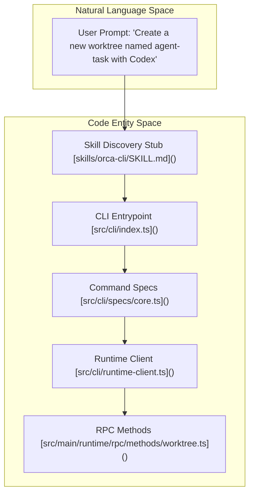
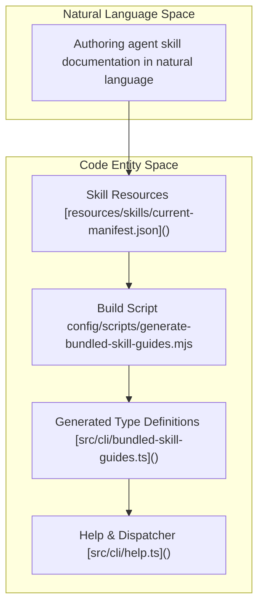

# Agent Skills & AI Coding Guidelines

This page documents the specialized skill sets and coding standards designed for AI agents (such as Claude or Codex) working within the Orca codebase. These guidelines, detailed primarily in `AGENTS.md`, the `skills/` directory, and enforced through custom lint ratchets, provide contextual instructions that ensure architectural consistency, cross-platform support, type safety, and reliable use of AI capabilities orchestrated by Orca.

---

## 1. Core Agent Rules & Environment Constraints

The foundational AI agent coding standards and environmental rules are gathered in the [`AGENTS.md`](AGENTS.md) file. They prescribe imperative conventions that agents and their skills must observe to maintain system safety, scalability, and uniform code quality [AGENTS.md:1-81]().

### Primary Directory & Worktree Safety

- Agents must **operate exclusively within the primary working directory (worktree)** for all file reads and edits. They must never follow absolute file paths produced by subagents that refer back to the main repository root, to prevent unsafe or inconsistent changes [AGENTS.md:64-66]().

### Commenting & Documentation

- Writing clear, **concise, and non-obvious comments only** is required. Comments should explain *why* a design or implementation choice was made, not provide verbose step-throughs of *how* the code works [AGENTS.md:21-25]().

### Lint Rules & Max Lines Ratchets

- It is mandatory to **never disable the `max-lines` linter rule** globally or per file (`eslint-disable max-lines`, `oxlint-disable max-lines`, or line-specific variants) [AGENTS.md:27-30](). Large files must be split or refactored.
- The [`config/max-lines-baseline.txt`](config/max-lines-baseline.txt:1-9) file lists existing oversized files allowed to exceed the oxlint `max-lines` budget. This list is a strict ratchet: entries may only shrink, never grow [config/max-lines-baseline.txt:1-4]().

### File and Module Naming

- Avoid vague filenames or module names such as `helpers`, `utils`, or `common`. Instead, use **domain-specific descriptive names** that precisely describe the contents (e.g., `tab-group-state.ts`, `terminal-orphan-cleanup.ts`) [AGENTS.md:31-33]().

### Cross-Platform Support & Windows Helpers

- All platform-dependent logic must be guarded by runtime checks:
  - For keyboard shortcuts, avoid hardcoding `e.metaKey`; check `navigator.userAgent.includes('Mac')` to pick `metaKey` on Mac and `ctrlKey` on Linux/Windows [AGENTS.md:72]().
  - Use `path.join` or Electron/Node path utilities instead of hardcoded `/` or `\` [AGENTS.md:74]().
  - Windows child processes must be spawned through `runProcess`/`spawnProcess` from `@orca/process-host` rather than `child_process` directly to pin `windowsHide` and prevent argument mangling [AGENTS.md:77-86]().

Sources:
[AGENTS.md:1-86]()
[config/max-lines-baseline.txt:1-8]()

---

## 2. Orca CLI Skill (`orca-cli`)

The `orca-cli` skill provides AI agents with access to Orca’s CLI commands, enabling them to manipulate Orca-managed worktrees, terminals, repos, automations, artifacts, embedded browsers, and skill sharing.

This skill is described in [`skills/orca-cli/SKILL.md`](skills/orca-cli/SKILL.md) and enjoys version-locked authoritative documentation served live by the Orca CLI binary itself to prevent drift.

### CLI Command Surface & Resolution

Key namespaces and example commands include:
- `repo list`, `repo add`, `repo show`, `repo set-base-ref` [`src/cli/specs/core.ts:37-65`]()
- `worktree list`, `worktree show`, `worktree create`, `worktree set` [`src/cli/specs/core.ts:67-143`]()

Agents resolve the correct CLI executable for the session following the environment and path precedence outlined in [`skills/orca-cli/SKILL.md`](skills/orca-cli/SKILL.md:17-28) (`ORCA_CLI_COMMAND`, `ORCA_DEV_REPO_ROOT`, `orca-ide`, or `orca`).

### Natural Language to Code Entity Bridge: CLI Dispatch

Sources:
[skills/orca-cli/SKILL.md:1-47]()
[src/cli/specs/core.ts:1-143]()
[src/cli/index.test.ts:90-121]()

---

## 3. Orchestration Skill (`orchestration`)

The `orchestration` skill supports structured multi-agent coordination in Orca by providing facilities for threaded messaging, blocking ask/reply flows, task dispatch, `worker_done` / escalation waits, and multi-agent task DAGs [skills/orchestration/SKILL.md:3-11]().

### Use Case Distinction

- Use `orca-cli` for ownership handoffs ("hand off", "handoff", "handover", "give this to another agent") when the user did not ask to supervise or coordinate a DAG [skills/orchestration/SKILL.md:8-10]().
- Use `orchestration` when supervising workers, managing task DAGs, or running coordinator loops [skills/orchestration/SKILL.md:3-10]().

Sources:
[skills/orchestration/SKILL.md:3-27]()

---

## 4. Specialized Skills, Bundled Guidance & Validation

### Skill Modules & Resources

Orca organizes specialized skills in `skills/`, with companion guides in `skill-guides/`, stubs in `skill-stubs/`, and resources in `resources/skills/`. Bundled skill guidance is generated and validated automatically via build scripts to ensure runtime synchronization [src/cli/bundled-skill-guides.ts:1-16]().

### Natural Language to Code Entity Bridge: Guidance Generation & Validation

Sources:
[src/cli/bundled-skill-guides.ts:1-16]()
[src/cli/help.ts:1-30]()
[resources/skills/current-manifest.json:1-1]()

---

## 5. Code-Quality Lint Ratchets & Restrictions

Orca enforces rigorous static analysis via `oxlint` and custom AST lint plugins defined in `config/oxlint-plugins/` and configured in [`.oxlintrc.json`](.oxlintrc.json) and [mobile/.oxlintrc.json](mobile/.oxlintrc.json:1-28).

### Key Restrictions and Lint Checks

- **Store Selectors**: Enforced by `app-store-performance/require-selector`, `no-identity-selector`, and `no-fresh-selector-result` to prevent unnecessary Zustand re-renders.
- **Restricted Package Imports**: Value-importing heavy bundles like `@linear/sdk` is strictly prohibited at the top level to protect eager loading; lint rules enforce `import type` paired with lazy resolvers like `loadLinearSdk()` from `src/main/linear/linear-sdk.ts`.
- **Non-Secure Context UUIDs**: In renderer code and web bundles, `crypto.randomUUID` is restricted in non-secure contexts; code must use `createBrowserUuid()` or `createNonSecureContextUuid()`.
- **`@ts-nocheck` Ratchet**: The [`config/ts-nocheck-baseline.txt`](config/ts-nocheck-baseline.txt:1-6) file lists files currently allowed to use `@ts-nocheck`. This is a ratchet, meaning the list may only shrink, and new entries are not permitted. These exist due to limitations in expressing forward references in split runtime mixin chains [config/ts-nocheck-baseline.txt:1-5]().

Sources:
[mobile/.oxlintrc.json:1-28]()
[config/max-lines-baseline.txt:1-8]()
[config/ts-nocheck-baseline.txt:1-5]()
