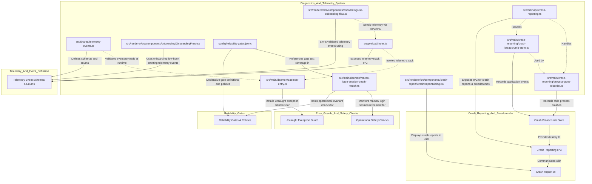
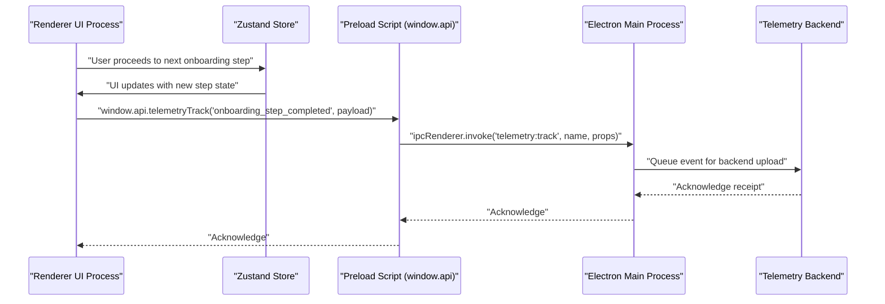

# Diagnostics, Telemetry & Reliability Gates

This page covers Orca’s systems for recording telemetry events, enforcing reliability gates, and implementing diagnostic workflows. These subsystems ensure high product reliability, enable operational safety checks, support onboarding telemetry, provide user feature nags, and guard against uncaught errors or lifecycle violations.

---

## Overview

Orca integrates a comprehensive diagnostics and telemetry framework that collects detailed event data from product usage and internal states. It complements this with enforceable reliability gates—rules that help maintain system correctness and prevent regressions. Together, these capabilities enhance the product experience, protect runtime stability, and enable insight-driven improvements.

The key areas detailed here include:

- **Telemetry Event Infrastructure:** Schemas, event classification, and the flow of event data from renderer and main process to telemetry backends.
- **Reliability Gates:** Declarative gate definitions, maturity levels, enforcement policies, and test coverage.
- **Diagnostics Workflows:** Onboarding telemetry and flow management, feature nags promptings, error guards catching uncaught exceptions, and operational safety monitoring (e.g., macOS login session retirement).
- **Crash Reporting & Breadcrumbs:** Mechanisms for capturing, reporting, and analyzing application crashes, including a sophisticated breadcrumb system.

---

## 1. Telemetry Event Recording

### 1.1 Telemetry Events Schema and Validation

Orca uses `src/shared/telemetry-events.ts` as the **single source of truth** for all telemetry event schemas and enumerations. This file defines:

- Event names and their *Zod* schemas for runtime validation.
- Enumerations of acceptable property values used for consistent event classification, such as `AgentKind`, `ErrorClass`, and `LaunchSource`.
- Predicate functions for event classification into cohorts (e.g., onboarding events).

Example constants include:

```typescript
export const AGENT_KIND_VALUES = [
  'claude-code', 'claude-agent-teams', 'openclaude', 'codex',
  // ... other agent kinds ...
  'other'
] as const;

export const agentKindSchema = z.enum(AGENT_KIND_VALUES);

export const errorClassSchema = z.enum(['binary_not_found', 'paste_readiness_timeout', 'unknown']);
```
[src/shared/telemetry-events.ts:7-27]()

Every telemetry event payload is validated at runtime using these strict Zod schemas, ensuring no extra or missing keys, and capped string length limits where appropriate.

### 1.2 Telemetry Data Flow

Telemetry events originate mostly from:

- **Renderer Process:** User interactions, onboarding flow steps, UI feature usages, and agent lifecycle notifications.
- **Main Process:** Lifecycle transitions, daemon health status, backend operations, and crash reporting.

Events transit from the renderer to the main process primarily via IPC channels registered in the preload script, which act as the telemetry client entry points. The main process queues and batches telemetry events, asynchronously flushing them to configured telemetry backend services.

For example, onboarding telemetry events are fired inside the renderer hook `useOnboardingFlow` [src/renderer/src/components/onboarding/use-onboarding-flow.ts:26]() (`src/renderer/src/components/onboarding/use-onboarding-flow.ts`). These events use the centrally defined schemas and are sent up via RPC/IPC to the main telemetry pipeline. The `telemetryTrack` function [src/preload/index.ts:91]() is used to dispatch these events.

Sources:
- [src/shared/telemetry-events.ts:1-68]()
- [src/renderer/src/components/onboarding/use-onboarding-flow.ts:1-139]()
- [src/preload/index.ts:91]()

---

## 2. Reliability Gates

### 2.1 Gate Manifest and Policy

Reliability gates in Orca are declaratively specified in the JSON manifest at `config/reliability-gates.jsonc`. This manifest describes:

- **Maturity Levels:** Stages all reliability features pass through, including `"experimental"`, `"soak"`, `"blocking"`, `"accepted-gap"`, and `"deprecated"` [config/reliability-gates.jsonc:5]().
- **Blocking Promotion Criteria:** For example, a gate must have at least `100` soak runs, be soaked for `14` days, and have zero unexplained flakes before blocking enforcement [config/reliability-gates.jsonc:7-9]().
- **Gate Definitions:** Each gate object declares
  - `id`, `title`, `maturity`, and `protection` scope [config/reliability-gates.jsonc:13-17]().
  - `owner` subsystem and `layer` of code [config/reliability-gates.jsonc:18-19]().
  - Affected UI/system `surfaces` [config/reliability-gates.jsonc:20]().
  - Supported `platforms` (e.g., `macos`, `linux`, `windows`) and execution `providers` (e.g., `local`, `ssh`, `remote-runtime`) [config/reliability-gates.jsonc:21-22]().
  - Formal `invariant` statements specifying the correctness property [config/reliability-gates.jsonc:29]().
  - Oracle definitions describing how tests verify the invariant [config/reliability-gates.jsonc:30]().
  - CLI test `commands` and referenced `testFiles` [config/reliability-gates.jsonc:31-38]().
  - Links to motivating issues and PRs [config/reliability-gates.jsonc:26-28]().
  - Detailed `coverageNotes` describing scope and test approach [config/reliability-gates.jsonc:25]().

**Example reliability gate excerpt:**

```jsonc
{
  "id": "agent-session.delayed-terminal-launch",
  "title": "Delayed terminal launches retain their harness preparation and recover process discovery",
  "maturity": "experimental",
  "protection": "partial",
  "owner": "terminal-runtime",
  "layer": "host-renderer",
  "surfaces": [
    "terminal startup commands",
    "typed agent commands",
    "hidden terminal startup",
    "agent hooks and managed accounts"
  ],
  "platforms": [
    "macos",
    "linux",
    "windows"
  ],
  "providers": [
    "local",
    "daemon",
    "ssh",
    "remote-runtime",
    "wsl"
  ],
  "coveredPlatforms": [
    "macos"
  ],
  "coveredProviders": [
    "local",
    "daemon"
  ],
  "coverageNotes": "Shared preparation is exercised with real local plugin files and account environment plus mocked host spawn contracts. Captured real Claude startup title drives renderer recovery. Physical Linux, Windows, SSH and WSL delayed launches remain unproved.",
  "motivatingLinks": [
    "docs/bug-reproductions/delayed-agent-launch.md"
  ],
  "invariant": "A literal sleep followed by && must not cause the later harness to lose hook/account preparation or hidden renderer query delivery. Preparation and typed-command hints are not live process evidence. Fresh agent startup output may request one bounded host confirmation after the initial command read window has expired.",
  "oracle": "All 45 configured harnesses keep hidden startup query eligibility. Delayed OpenCode 2 installs v2 hooks rather than v1, disabled harnesses do not fall back, selected managed accounts survive, and Pi/OMP/Prime preparation targets the requested harness. A captured Claude startup title at 30 seconds yields process-confirmed routing, never title-authorized routing. A title storm causes at most three additional reads; close and untrackable providers cause none.",
  "commands": [
    "ORCA_BACKGROUND_LAUNCH=1 pnpm test src/shared/agent-command-line-intent.test.ts src/shared/pi-agent-kind.test.ts src/shared/opencode-launch-command.test.ts src/main/ipc/pty/host-env/opencode-hook-installation.test.ts src/main/ipc/pty-spawn-env-terminal-basics.test.ts src/main/managed-data-accounts/launch-environment.test.ts src/renderer/src/components/terminal-pane/terminal-startup-command-classifier.test.ts src/renderer/src/components/terminal-pane/pane-delayed-agent-startup.test.ts src/renderer/src/components/terminal-pane/pty-connection-foreground-agent-routing.test.ts src/renderer/src/components/terminal-pane/pty-connection-hidden-codex-queries.test.ts --maxWorkers=2"
  ],
  "testFiles": [
    "src/shared/agent-command-line-intent.test.ts",
    "src/shared/pi-agent-kind.test.ts",
    "src/shared/opencode-launch-command.test.ts",
    "src/main/ipc/pty/host-env/opencode-hook-installation.test.ts",
    "src/main/ipc/pty-spawn-env-terminal-basics.test.ts",
    "src/main/managed-data-accounts/launch-environment.test.ts",
    "src/renderer/src/components/terminal-pane/terminal-startup-command-classifier.test.ts",
    "src/renderer/src/components/terminal-pane/pane-delayed-agent-startup.test.ts",
    "src/renderer/src/components/terminal-pane/pty-connection-foreground-agent-routing.test.ts",
    "src/renderer/src/components/terminal-pane/pty-connection-hidden-codex-queries.test.ts"
  ],
  "assertionRefs": [
    {
      "file": "src/main/ipc/pty/host-env/opencode-hook-installation.test.ts",
      "assertions": [
        "explicit %s with disabled"
      ]
    },
    {
      "file": "src/renderer/src/components/terminal-pane/terminal-startup-command-classifier.test.ts",
      "assertions": [
        "keeps hidden %s startup queries live after sleep"
      ]
    },
    {
      "file": "src/renderer/src/components/terminal-pane/pane-delayed-agent-startup.test.ts",
      "assertions": [
        "bounds a startup title storm to one extra read ladder and never adopts the title as identity",
        "cancels delayed startup discovery on close"
      ]
    },
    {
      "file": "src/renderer/src/components/terminal-pane/pty-connection-foreground-agent-routing.test.ts",
      "assertions": [
        "confirms a delayed Claude from fresh startup output after the first read window expires"
      ]
    }
  ],
  "evidenceRuns": [
    {
      "date": "2026-10-13",
      "runner": "local",
      "platform": "macos",
      "command": "ORCA_BACKGROUND_LAUNCH=1 pnpm test src/shared/agent-command-line-intent.test.ts src/shared/pi-agent-kind.test.ts src/shared/opencode-launch-command.test.ts src/main/ipc/pty/host-env/opencode-hook-installation.test.ts src/main/ipc/pty-spawn-env-terminal-basics.test.ts src/main/managed-data-accounts/launch-environment.test.ts src/renderer/src/components/terminal-pane/terminal-startup-command-classifier.test.ts src/renderer/src/components/terminal-pane/pane-delayed-agent-startup.test.ts src/renderer/src/components/terminal-pane/pty-connection-foreground-agent-routing.test.ts src/renderer/src/components/terminal-pane/pty-connection-hidden-codex-queries.test.ts --maxWorkers=2",
      "result": "passed",
      "durationSeconds": 1.86,
      "summary": "214 assertions pass across nine files, including all 45 harness classifications, actual hook files, delayed account preparation, late process routing, hidden query delivery and bounded recovery."
    }
  ],
  "runtimeBudget": {
    "p95Seconds": 30,
    "scope": "Focused deterministic gate; no CI soak established."
  },
  "performanceBudget": {
    "required": true,
    "evidence": "Prefix scanning is capped at 4096 characters; ordinary output has no additional work. Startup title recovery uses one existing three-read ladder per command and joins active reads. Deterministic counts cover storms, close and untrackable providers."
  },
  "flakeHistory": {
    "status": "not-started",
    "evidence": "Focused macOS runs passed; no cross-platform soak."
  },
  "redGreenEvidence": {
    "status": "complete",
    "evidence": "Before the fix, delayed preparation produced 52 failing assertions and the captured late Claude startup title left process routing unset. The corresponding tests passed after the change."
  },
  "promotionCriteria": [
    "Collect repeated independent runs and physical provider/platform evidence before promotion."
  ],
  "knownGaps": [
    "Real Claude hooks completed normally in the original macOS reproduction; no blanket hook outage was reproduced.",
    "Physical Linux, Windows, SSH and WSL delayed launches remain unproved."
  ],
  "demotionRule": "Keep experimental until cross-platform and soak evidence; investigate failures without weakening content or memory assertions."
}
```
[config/reliability-gates.jsonc:12-124]()

### 2.2 Enforcement and Integration with CI

The manifest file is verified during CI runs to ensure:

- It adheres to the expected schema and maintains declarative consistency.
- That the linked tests for each gate pass successfully.
- That coverage and enforcement policies are maintained to prevent regression.

An example from the pull request CI workflow `.github/workflows/pr.yml` shows a step ensuring gate manifest correctness:

```yaml
- name: Check reliability gate manifest
  run: pnpm run check:reliability-gates
```
[config/scripts/pr-e2e-gate-contract.test.mjs:21-24]()

If any blocking gate test fails or the manifest validation fails, the CI stops merge progression until issues are resolved, preventing regressions in critical reliability areas. The `pr-e2e-gate-contract.test.mjs` script [config/scripts/pr-e2e-gate-contract.test.mjs:1-149]() specifically tests the contract of these gates within the CI workflow.

Sources:
- [config/reliability-gates.jsonc:1-124]()
- [config/scripts/pr-e2e-gate-contract.test.mjs:1-149]()
- [.github/workflows/e2e.yml:1-187]()

---

## 3. Diagnostics Workflows

### 3.1 Onboarding Telemetry and Flow Management

Orca's onboarding flow is tightly instrumented for telemetry, capturing events like step completions, user skips, and feature interactions. The hook `useOnboardingFlow` [src/renderer/src/components/onboarding/use-onboarding-flow.ts:30]() (`src/renderer/src/components/onboarding/use-onboarding-flow.ts`) manages:

- State transitions between onboarding steps [src/renderer/src/components/onboarding/use-onboarding-flow.ts:63]().
- Conditions to skip certain onboarding steps based on platform or device environment [src/renderer/src/components/onboarding/use-onboarding-flow.ts:51-52]().
- Persistent state saving of progress and selected options, handled by `usePersistCurrentStep` [src/renderer/src/components/onboarding/use-onboarding-flow-persistence.ts]().
- Emission of telemetry events tracking user decisions and flow progression, via the `telemetryTrack` function [src/preload/index.ts:91]().

The React component `OnboardingFlow.tsx` [src/renderer/src/components/onboarding/OnboardingFlow.tsx:125]() (`src/renderer/src/components/onboarding/OnboardingFlow.tsx`) coordinates UI rendering of steps, skip confirmation dialogs [src/renderer/src/components/onboarding/OnboardingFlow.tsx:140](), keyboard shortcut bindings [src/renderer/src/components/onboarding/OnboardingFlow.tsx:165-182](), and emits telemetry on relevant user actions.

### 3.2 Feature Nags and Notification Guards

Feature nags like the GitHub star nags prompt users to engage with the project, conditionally displayed based on telemetry cohorts and past user behavior. These nags suppress repetition after completion or user opt-out. The `StarNagCard.tsx` component [src/renderer/src/components/StarNagCard.tsx]() is an example of such a nag.

Users starring Orca on GitHub disable future nags, exemplifying telemetry-driven feature nag management.

### 3.3 Error Guards and Operational Safety Checks

The daemon entry point (`src/main/daemon/daemon-entry.ts`) installs dedicated uncaught exception handlers designed to:

- Capture runtime exceptions, especially those related to native PTY modules that might cause process crashes.
- Prevent crash loops by logging problematic errors without exiting immediately.
- Preserve process stability through operational crash guards.

Additionally, Orca incorporates OS-specific operational safety monitoring. For example, on macOS, module `macos-login-session-death-watch.ts` watches for login session retirement via PAM failures, employing delayed retirement backoff to avoid false daemon shutdowns due to transient PAM rejections.

Sources:
- [src/renderer/src/components/onboarding/use-onboarding-flow.ts:1-139]()
- [src/renderer/src/components/onboarding/OnboardingFlow.tsx:1-192]()
- [src/renderer/src/components/StarNagCard.tsx]()
- [src/main/star-nag/service.ts]()
- [src/main/daemon/daemon-entry.ts]()
- [src/main/daemon/macos-login-session-death-watch.ts]()
- [src/preload/index.ts:91]()

---

## 4. Crash Reporting and Breadcrumbs

Orca implements a robust crash reporting system that captures detailed information about application crashes and allows users to submit these reports. A key component of this system is the breadcrumb store, which records a history of application events leading up to a crash.

### 4.1 Crash Breadcrumb Store

The `CrashBreadcrumbStore` [src/main/crash-reporting/crash-breadcrumb-store.ts:36]() in `src/main/crash-reporting/crash-breadcrumb-store.ts` manages a fixed-size ring buffer of `CrashReportBreadcrumb` objects.

- **`recordCrashBreadcrumb(name, data, origin)`**: Records a new breadcrumb. It sanitizes the data and adds it to the `breadcrumbs` array [src/main/crash-reporting/crash-breadcrumb-store.ts:56-86]().
- **Fair-Share Eviction**: When the `breadcrumbs` array exceeds `MAX_BREADCRUMBS` (30) [src/main/crash-reporting/crash-breadcrumb-store.ts:8](), the `evictionIndex` function [src/main/crash-reporting/crash-breadcrumb-store.ts:88]() determines which breadcrumb to remove. This eviction strategy prioritizes removing entries from the most frequently occurring series, rather than simply the oldest, to preserve a diverse history of events [src/main/crash-reporting/crash-breadcrumb-store.ts:93-107]().
- **Coalesced Breadcrumbs**: The `recordCoalescedCrashBreadcrumb` function [src/main/crash-reporting/crash-breadcrumb-store.ts:166]() handles repetitive events by coalescing them into a single breadcrumb, suppressing repeated entries within a `minIntervalMs` [src/main/crash-reporting/crash-breadcrumb-store.ts:170-177](). This prevents the breadcrumb buffer from being overwhelmed by a single type of frequent event.
- **Retained Breadcrumbs**: Certain critical, non-repeating events (e.g., `renderer_memory_highwater`) are stored in a separate `retainedBreadcrumbs` map [src/main/crash-reporting/crash-breadcrumb-store.ts:37](), ensuring they are always present in a crash report, up to `MAX_RETAINED_BREADCRUMBS` (8) [src/main/crash-reporting/crash-breadcrumb-store.ts:10]().

### 4.2 Process Gone Recording

The `recordProcessGoneCrash` function [src/main/crash-reporting/process-gone-recorder.ts:21]() in `src/main/crash-reporting/process-gone-recorder.ts` is responsible for recording crashes of child processes (e.g., renderer processes).

- It uses `ProcessGoneDedupe` [src/main/crash-reporting/process-gone-dedupe.ts]() to prevent duplicate crash reports for the same process gone event, especially during crash loops [src/main/crash-reporting/process-gone-recorder.test.ts:171-196]().
- It records a `process_gone_suppressed` breadcrumb if a crash is expected (e.g., during a renderer reload) [src/main/crash-reporting/process-gone-recorder.test.ts:93-100]().
- If the crash report store is unavailable, it records a `crash_report_store_unavailable` breadcrumb [src/main/crash-reporting/process-gone-recorder.test.ts:72-82]().

### 4.3 Crash Reporting IPC and UI

The main process exposes IPC handlers for crash reporting in `src/main/ipc/crash-reporting.ts`.

- **`crashReports:getLatestPending`**: Retrieves the latest pending crash report [src/main/ipc/crash-reporting.ts:49]().
- **`crashReports:getLatestReport`**: Retrieves the latest sendable crash report [src/main/ipc/crash-reporting.ts:52]().
- **`crashReports:dismiss`**: Dismisses a crash report [src/main/ipc/crash-reporting.ts:55]().
- **`crashReports:recordBreadcrumb`**: Allows renderer processes to record breadcrumbs [src/main/ipc/crash-reporting.ts:65]().
- **`crashReports:copyLatestDiagnostics`**: Copies crash diagnostics to the clipboard [src/main/ipc/crash-reporting.ts:78]().
- **`crashReports:recordRendererError`**: Records an error from the renderer process [src/main/ipc/crash-reporting.ts:101]().
- **`crashReports:submit`**: Submits a crash report [src/main/ipc/crash-reporting.ts:111]().

The `CrashReportDialog` component [src/renderer/src/components/crash-report/CrashReportDialog.tsx:16]() in `src/renderer/src/components/crash-report/CrashReportDialog.tsx` is responsible for displaying crash reports to the user and allowing them to submit or dismiss them. It listens for `REACT_ERROR_BOUNDARY_REPORT_AVAILABLE_EVENT` [src/renderer/src/components/crash-report/CrashReportDialog.tsx:82]() to show reports from React error boundaries.

Sources:
- [src/main/crash-reporting/crash-breadcrumb-store.ts:1-179]()
- [src/main/crash-reporting/crash-breadcrumb-store.test.ts:1-170]()
- [src/main/crash-reporting/process-gone-recorder.ts]()
- [src/main/crash-reporting/process-gone-recorder.test.ts:1-208]()
- [src/main/ipc/crash-reporting.ts:1-115]()
- [src/renderer/src/components/crash-report/CrashReportDialog.tsx:1-118]()
- [src/shared/crash-reporting.ts]()

---

## 5. Diagram: Natural Language to Code Entity Overview



*Diagram Explanation:*
- `telemetry-events.ts` holds authoritative telemetry schemas used by the renderer onboarding components (`use-onboarding-flow.ts`, `OnboardingFlow.tsx`). The `preload/index.ts` exposes the `telemetryTrack` IPC function, which is then handled by the main process daemon (`daemon-entry.ts`) to forward telemetry data.
- Reliability gates are declared in the manifest and operationalized by modules such as the macOS session watcher.
- The daemon entry installs process-wide error guards.
- The `CrashBreadcrumbStore` and `ProcessGoneRecorder` in the main process collect diagnostic information, which is exposed via `crash-reporting.ts` IPC handlers and presented to the user through the `CrashReportDialog` in the renderer.

Sources:
- [src/shared/telemetry-events.ts:1-68]()
- [src/renderer/src/components/onboarding/use-onboarding-flow.ts:1-139]()
- [src/renderer/src/components/onboarding/OnboardingFlow.tsx:1-192]()
- [src/main/daemon/daemon-entry.ts]()
- [config/reliability-gates.jsonc:1-124]()
- [src/main/daemon/macos-login-session-death-watch.ts]()
- [src/main/crash-reporting/crash-breadcrumb-store.ts:1-179]()
- [src/main/crash-reporting/process-gone-recorder.ts]()
- [src/main/ipc/crash-reporting.ts:1-115]()
- [src/renderer/src/components/crash-report/CrashReportDialog.tsx:1-118]()
- [src/preload/index.ts:91]()

---

## 6. Data Flow Example: Onboarding Telemetry Event Recording



This flow shows how user interactions in the renderer generate telemetry events. These events are strictly validated and transmitted via IPC and RPC to the main process, which then dispatches them to backend telemetry services.

Sources:
- [src/renderer/src/components/onboarding/use-onboarding-flow.ts:6]()
- [src/preload/index.ts:91]()
- [src/main/ipc/telemetry.ts]()

---

## 7. Reliability Gate Enforcement in CI

Reliability gates are continuously enforced within automated CI pipelines including GitHub Actions. Relevant test commands specified in the gate manifest run as part of the gating:

```jsonc
"testFiles": [
  "src/shared/agent-command-line-intent.test.ts",
  "src/shared/pi-agent-kind.test.ts",
  "src/shared/opencode-launch-command.test.ts",
  "src/main/ipc/pty/host-env/opencode-hook-installation.test.ts",
  "src/main/ipc/pty-spawn-env-terminal-basics.test.ts",
  "src/main/managed-data-accounts/launch-environment.test.ts",
  "src/renderer/src/components/terminal-pane/terminal-startup-command-classifier.test.ts",
  "src/renderer/src/components/terminal-pane/pane-delayed-agent-startup.test.ts",
  "src/renderer/src/components/terminal-pane/pty-connection-foreground-agent-routing.test.ts",
  "src/renderer/src/components/terminal-pane/pty-connection-hidden-codex-queries.test.ts"
],
"commands": [
  "ORCA_BACKGROUND_LAUNCH=1 pnpm test src/shared/agent-command-line-intent.test.ts src/shared/pi-agent-kind.test.ts src/shared/opencode-launch-command.test.ts src/main/ipc/pty/host-env/opencode-hook-installation.test.ts src/main/ipc/pty-spawn-env-terminal-basics.test.ts src/main/managed-data-accounts/launch-environment.test.ts src/renderer/src/components/terminal-pane/terminal-startup-command-classifier.test.ts src/renderer/src/components/terminal-pane/pane-delayed-agent-startup.test.ts src/renderer/src/components/terminal-pane/pty-connection-foreground-agent-routing.test.ts src/renderer/src/components/terminal-pane/pty-connection-hidden-codex-queries.test.ts --maxWorkers=2"
]
```
[config/reliability-gates.jsonc:53-98]()

In `.github/workflows/pr.yml`, a step verifies reliability gates:

```yaml
- name: Check reliability gate manifest
  run: pnpm run check:reliability-gates
```
[config/scripts/pr-e2e-gate-contract.test.mjs:21-24]()

This step ensures the manifest is structurally sound, test commands execute successfully, and coverage remains intact. Failure blocks merges/releases until resolved. The `pr-e2e-gate-contract.test.mjs` script [config/scripts/pr-e2e-gate-contract.test.mjs:1-149]() specifically validates the integrity of the reliability gate definitions and their integration with the CI system.

Sources:
- [config/reliability-gates.jsonc:12-124]()
- [config/scripts/pr-e2e-gate-contract.test.mjs:1-149]()
- [.github/workflows/e2e.yml:1-187]()

---

## 8. Summary of Key Code Entities

| Entity                            | Location                                                 | Role Description                                                    |
|----------------------------------|----------------------------------------------------------|--------------------------------------------------------------------|
| `eventSchemas` and `EventMap`    | `src/shared/telemetry-events.ts`                         | Single source of truth for telemetry events, properties, enums, and validation |
| `telemetryTrackApi`              | `src/preload/index.ts`                                   | IPC bridge for sending telemetry events from renderer to main process |
| `useOnboardingFlow` hook         | `src/renderer/src/components/onboarding/use-onboarding-flow.ts` | Controls onboarding step lifecycle, emits telemetry on step changes |
| `OnboardingFlow` component       | `src/renderer/src/components/onboarding/OnboardingFlow.tsx`     | UI component combining onboarding UI with telemetry event emission |
| `reliability-gates.jsonc`        | `config/reliability-gates.jsonc`                         | Declarative manifest describing reliability gates, enforcement policy, and tests |
| `daemon-entry.ts`                | `src/main/daemon/daemon-entry.ts`                        | Daemon process entrypoint; installs uncaught error guards and telemetry integration |
| `macos-login-session-death-watch.ts` | `src/main/daemon/macos-login-session-death-watch.ts`       | Monitors macOS login session lifecycle; operational gate implementation |
| `CrashBreadcrumbStore`           | `src/main/crash-reporting/crash-breadcrumb-store.ts`     | Manages a fixed-size ring buffer of application event breadcrumbs for crash reports |
| `ProcessGoneDedupe`              | `src/main/crash-reporting/process-gone-dedupe.ts`        | Deduplicates and coalesces child process crash events to prevent report spam |
| `registerCrashReportingHandlers` | `src/main/ipc/crash-reporting.ts`                        | Registers IPC handlers for crash report submission, dismissal, and breadcrumb recording |
| `CrashReportDialog`              | `src/renderer/src/components/crash-report/CrashReportDialog.tsx` | React component for displaying and interacting with crash reports |

---

## 9. Additional Notes

- Telemetry payloads are validated using *Zod* schemas to prevent drift and enforce strict typing.
- Reliability gates encode critical system invariants with clear maturation lifecycle, blocking regressions and encouraging soak testing.
- Onboarding telemetry events enable measurement of user activation and feature adoption funnels.
- The daemon process guards against crash loops with native PTY error survivors.
- macOS login session retirement monitoring uses a robust burst detection to defer daemon shutdown, avoiding false positives.
- Crash reporting includes a sophisticated breadcrumb system with fair-share eviction and coalescing to provide meaningful context for debugging.

---

This completes the detailed technical overview of diagnostics, telemetry, and reliability gates implemented in Orca. The integration of careful schema validation, declarative gating, and operational safety monitors enables a stable product with actionable insight.

# End of 9.3 Diagnostics, Telemetry & Reliability Gates

---

**Sources:**

- [src/shared/telemetry-events.ts:1-68]()
- [src/renderer/src/components/onboarding/use-onboarding-flow.ts:1-139]()
- [src/renderer/src/components/onboarding/OnboardingFlow.tsx:1-192]()
- [config/reliability-gates.jsonc:1-124]()
- [config/scripts/pr-e2e-gate-contract.test.mjs:1-149]()
- [src/main/daemon/daemon-entry.ts]()
- [src/main/daemon/macos-login-session-death-watch.ts]()
- [src/main/crash-reporting/crash-breadcrumb-store.ts:1-179]()
- [src/main/crash-reporting/crash-breadcrumb-store.test.ts:1-170]()
- [src/main/crash-reporting/process-gone-recorder.ts]()
- [src/main/crash-reporting/process-gone-recorder.test.ts:1-208]()
- [src/main/crash-reporting/process-gone-dedupe.ts]()
- [src/main/ipc/crash-reporting.ts:1-115]()
- [src/renderer/src/components/crash-report/CrashReportDialog.tsx:1-118]()
- [src/shared/crash-reporting.ts]()
- [src/main/star-nag/service.ts]()
- [src/renderer/src/components/StarNagCard.tsx]()
- [src/main/ipc/telemetry.ts]()
- [src/preload/index.ts:91]()
