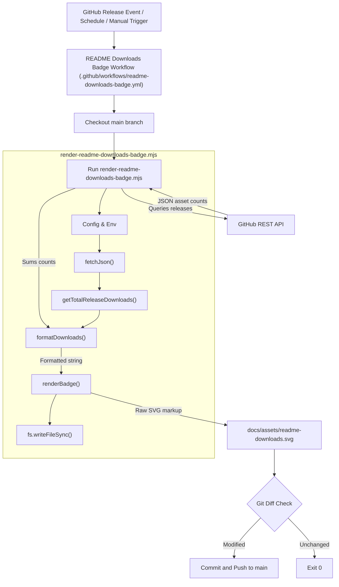

# Documentation Site & Assets

This page details the `docs/` directory, which encompasses the documentation website (`docs/site`), multilingual READMEs (`docs/readme/`), reference documentation, and dynamically generated README badges (`docs/assets/`). The documentation site is built using Next.js and provides content management, versioning, and deployment capabilities. Multilingual READMEs ensure broad global accessibility, while generated badges provide real-time project metrics.

## Multilingual READMEs

The Orca project provides its main `README.md` in multiple languages to cater to an international developer community. These translated READMEs are located under `docs/readme/`.

The root `README.md` [README.md:1-161]() includes a language selector at the top, linking to its translated variants. For instance, the Simplified Chinese edition is linked at `docs/readme/README.zh-CN.md` [README.md:15](). Each translated README—such as Simplified Chinese [docs/readme/README.zh-CN.md:1-175](), Korean [docs/readme/README.ko.md:1-165](), Spanish [docs/readme/README.es.md:1-154](), Japanese [docs/readme/README.ja.md:1-165](), French [docs/readme/README.fr.md:1-152](), and Portuguese [docs/readme/README.pt.md:1-154]()—maintains the same structural layout and visual assets as the English original, with localized prose.

The directory layout for multilingual documentation comprises:
- `README.md`: English (project root)
- `docs/readme/README.zh-CN.md`: Simplified Chinese
- `docs/readme/README.ja.md`: Japanese
- `docs/readme/README.ko.md`: Korean
- `docs/readme/README.es.md`: Spanish
- `docs/readme/README.fr.md`: French
- `docs/readme/README.pt.md`: Portuguese

These files are standard Markdown documents referencing shared repository assets like `resources/build/icon.png` and `docs/assets/readme-hero.jpg` via relative paths [README.md:26]().

Sources:
- [README.md:1-161]()
- [docs/readme/README.zh-CN.md:1-175]()
- [docs/readme/README.ko.md:1-165]()
- [docs/readme/README.es.md:1-154]()
- [docs/readme/README.ja.md:1-165]()
- [docs/readme/README.fr.md:1-152]()
- [docs/readme/README.pt.md:1-154]()

## Generated README Badges

The project uses dynamically generated badges to display real-time repository information, such as cumulative release downloads. These badges are static SVG graphics updated automatically via scheduled GitHub Actions workflows.

### Downloads Badge

The downloads badge, located at `docs/assets/readme-downloads.svg` [docs/assets/readme-downloads.svg:1-21](), renders the total download count across all GitHub releases. This badge is embedded directly into the primary `README.md` [README.md:7]() and all localized README variants [docs/readme/README.zh-CN.md:7]().

#### Downloads Badge Generation Workflow

The GitHub Actions workflow `.github/workflows/readme-downloads-badge.yml` automates badge updates.

**Workflow Triggers:**
- `workflow_dispatch`: Manual execution.
- `schedule`: Automated cron execution every 6 hours.
- `release`: Triggered upon `published`, `edited`, or `deleted` release lifecycle events.

**Workflow Execution Steps:**
1.  **Checkout main**: Checks out the target branch.
2.  **Render downloads badge**: Invokes the Node.js automation script `render-readme-downloads-badge.mjs` to query release assets and re-render the SVG.
3.  **Commit badge update**: If the newly generated SVG differs from the committed version, it commits `docs/assets/readme-downloads.svg` and pushes changes back to `main`.

#### Downloads Badge Script (`render-readme-downloads-badge.mjs`)

The badge generator script `.github/scripts/render-readme-downloads-badge.mjs` performs the following programmatic phases:

1.  **Configuration**: Sets up API targets (`stablyai/orca`), authentication tokens (`GITHUB_TOKEN`), and target output paths (`docs/assets/readme-downloads.svg`).
2.  **API Transport (`fetchJson`)**: Authenticated helper making GET queries to the GitHub REST API.
3.  **Aggregation (`getTotalReleaseDownloads`)**: Paginates through repository releases (100 items per page) and sums the `download_count` property across all attached assets, bypassing draft releases.
4.  **Formatting (`formatDownloads`)**: Converts raw integers into human-readable shorthand strings (e.g., `81m`).
5.  **SVG Rendering (`renderBadge`)**: Dynamically constructs XML text blocks representing badge pill dimensions, label backgrounds, and font nodes.

**Diagram: Downloads Badge Generation Flow**

Sources:
- [docs/assets/readme-downloads.svg:1-21]()
- [README.md:7]()
- [docs/readme/README.zh-CN.md:7]()
- [.github/workflows/readme-downloads-badge.yml]()
- [.github/scripts/render-readme-downloads-badge.mjs]()

## Documentation Site (`docs/site`)

The `docs/site` directory contains the Next.js application powering the official Orca documentation website (`onorca.dev/docs`). It features MDX-based content rendering, version selectors, and built-in search.

### Mobile Companion App Integration & Links

Both the Next.js documentation site and the desktop client settings reference canonical mobile companion links. These URLs are centralized in configuration modules like `src/renderer/src/components/mobile/mobile-platform-copy.ts` [src/renderer/src/components/mobile/mobile-platform-copy.ts:1-42]() and rendered via `src/renderer/src/components/settings/MobileSettingsPane.tsx` [src/renderer/src/components/settings/MobileSettingsPane.tsx:1-98]().

-   **iOS App Store URL**: `https://apps.apple.com/app/orca-ide/id6766130217` [src/renderer/src/components/settings/MobileSettingsPane.tsx:14](), [src/renderer/src/components/mobile/mobile-platform-copy.ts:15]().
-   **iOS TestFlight URL**: `https://testflight.apple.com/join/YjeGMQBA` [src/renderer/src/components/mobile/mobile-platform-copy.ts:19]().
-   **Android APK URL**: `https://www.onorca.dev/download/android` [src/renderer/src/components/settings/MobileSettingsPane.tsx:15](), [src/renderer/src/components/mobile/mobile-platform-copy.ts:25-26]().
-   **Android Install Guide URL**: `https://www.onorca.dev/docs/android-apk` [src/renderer/src/components/mobile/mobile-platform-copy.ts:10]().

The `MobileSettingsPane` component [src/renderer/src/components/settings/MobileSettingsPane.tsx:18-98]() renders these download endpoints inside the application settings panel, using `getInstallCopy` [src/renderer/src/components/mobile/mobile-platform-copy.ts:28]() to adapt UI labels based on host platform selections.

Sources:
- [src/renderer/src/components/settings/MobileSettingsPane.tsx:1-98]()
- [src/renderer/src/components/mobile/mobile-platform-copy.ts:1-42]()
