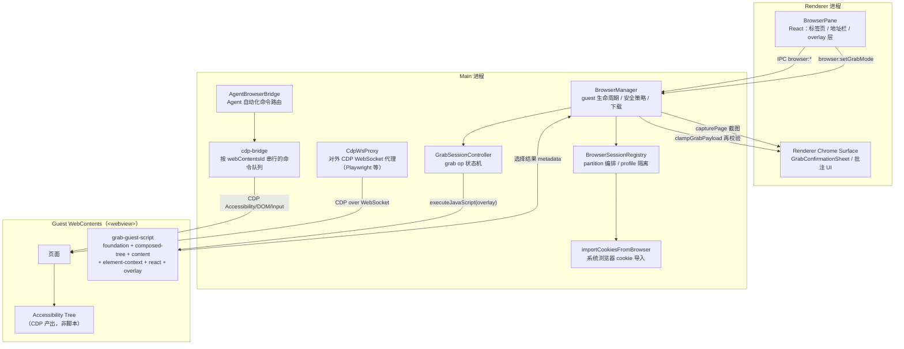
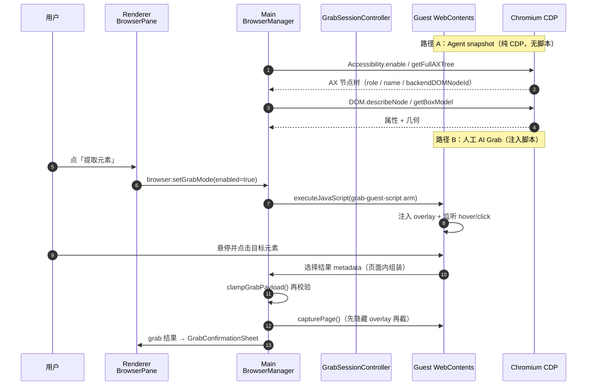
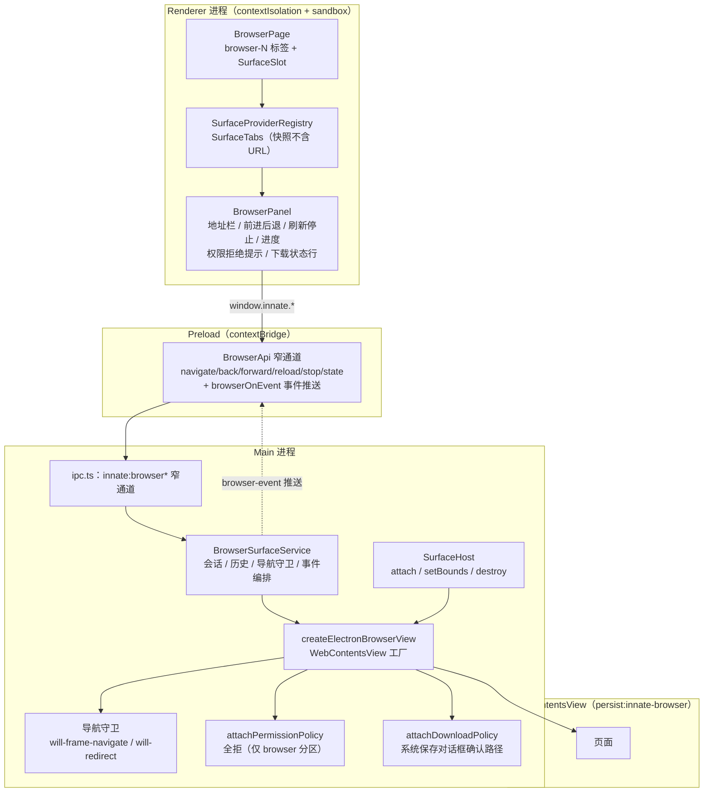
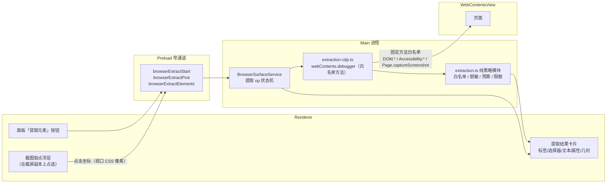

# orca browser 模块分析（arch-diagram）与 innate 提取元素方案

> 日期：2026-11-02 · 对应 issue [#11](https://github.com/qdriven/innate-desktop/issues/11)
> 分析对象：`stablyai/orca` 的 browser 模块（deepwiki 全量导出见本目录），对照本仓
> `innate-dogic/plugins/browser` 与 `apps/desktop` 的现状。
> 目的：确定「浏览器体验优化」的取舍，特别是**提取元素**（element extraction）该怎么落地。

## 0. 结论先行

| 议题 | 结论 |
| --- | --- |
| orca 的浏览器怎么做的 | `<webview>` guest + `BrowserManager`（主进程）+ `BrowserPane`（renderer）+ `AgentBrowserBridge`（Agent 自动化）+ `CdpWsProxy`（对外 CDP 代理） |
| orca 的「提取元素」有两条路 | ① **Agent snapshot**：纯 CDP `Accessibility.getFullAXTree`，**不执行页面脚本**；② **人工 AI Grab**：`executeJavaScript` 注入 overlay 脚本，让用户点选元素 |
| 本仓能不能抄② | **不能直接抄**。本仓 browser 视图抽象明确「不提供任何页面脚本执行通道」（`plugins/browser/src/main/index.ts`），②与之正面冲突 |
| 本仓该怎么做 | 走 **纯 CDP 路线**：用 `DOM.getNodeForLocation` + `DOM.describeNode` 做「点选提取」，用 `Accessibility.getFullAXTree` 做「页面元素清单」，**全程零页面脚本** |
| 净收益 | 拿到与 orca AI Grab 等价的「点一下取元素」体验，同时**不放宽**本仓已有的红线（无 `executeJavaScript`、renderer 只拿安全字段） |

---

## 1. orca browser 模块骨架（arch-diagram）

### 1.1 五层结构



### 1.2 「提取元素」的两条路径（重点）



**路径 A 与 B 的关键差异**：

| 维度 | A：Agent snapshot | B：人工 AI Grab |
| --- | --- | --- |
| 取数方式 | CDP `Accessibility.getFullAXTree` | `executeJavaScript` 注入页面脚本 |
| 是否执行页面脚本 | **否** | **是** |
| 需要用户点选 | 否 | 是 |
| 产出粒度 | role / name / backendDOMNodeId（可再 `DOM.describeNode` 补属性） | tagName / selector / attributes / a11y / computedStyles / 文本 / HTML 片段 / 截图 |
| 安全边界 | 主进程白名单内发 CDP 命令 | 页面脚本在页面上下文运行，需在 main 侧二次校验 |

### 1.3 orca grab 路径的安全设计（值得直接抄的部分）

来源：`src/shared/browser-grab-types.ts`、`src/main/browser/browser-grab-payload.ts`

1. **属性白名单**：只保留 `id/class/name/type/role/href/src/alt/title/placeholder/for/action/method`，
   外加全部 `aria-*`；其余属性直接丢弃。
2. **凭据形态脱敏**：`GRAB_SECRET_PATTERNS`（`access_token`/`api_key`/`client_secret`/
   `oauth_state`/`session_id`/`csrf`/`secret`/`password`…）命中即替换为 `[redacted]`。
   注释明确：不做「code/state」这类宽泛匹配——它们会误伤普通 CSS class。
3. **URL 二次净化**：`href`/`src`/`action` 只保留 `http/https/file`，并剥掉 query 与 hash。
4. **双层校验**：guest 侧启发式脱敏后，**main 进程边界再跑一遍**
   （`clampGrabPayload` 注释原文：“Repeat guest-side secret heuristics at the main-process boundary.”）。
5. **长度预算**：`GRAB_BUDGET` 逐字段限额（文本 200B、HTML 片段 4096B、选择器 700B、
   路径 900B、祖先链 10 项、邻近文本 10 项……），截图硬上限 2MB。
6. **调用方授权**：`getAuthorizedGuest` 校验 `senderWebContentsId` 必须等于该标签注册的
   renderer，伪造来源拿不到 guest。
7. **计算样式白名单**：只取 16 个属性（display/position/尺寸/内外边距/颜色/边框/字体/z-index），
   不整体 dump `getComputedStyle`。

> 本仓要抄的是 **1/2/3/4/5/6/7**，**不抄**「注入页面脚本」这件事本身。

---

## 2. 本仓 browser 现状（arch-diagram）



**已有硬约束（本方案不得破坏）**：

- 视图抽象**不提供** `executeJavaScript` 或任何页面脚本执行通道（`BrowserSurfaceView` 注释）。
- renderer 只提交安全字段（会话 id + URL），拿不到 webContents / session / cookie。
- 协议白名单仅 `http/https`，拒绝内嵌凭据；重定向逐跳校验。
- 权限全拒；下载必须经系统保存对话框。
- 布局快照只存普通 URL，不存 DOM / cookie / 表单。

---

## 3. 差距分析与方案选择

### 3.1 orca 有、我们没有的

| 能力 | orca | 本仓 | 是否要 |
| --- | --- | --- | --- |
| 页面元素清单（AX 树） | 有（`snapshot`） | 无 | **要**——这是 Agent 上下文的最小可用单元 |
| 用户点选元素取上下文 | 有（AI Grab） | 无 | **要**（issue #11 明确要求「提取元素」） |
| 元素截图 | 有 | 无 | 可选（v1.2） |
| 对外 CDP 代理（Playwright） | 有 | 无 | 不要——超出当前产品面，且等于放开整条 CDP 面 |
| 系统浏览器 cookie 导入 | 有 | 无 | 不要——与「浏览器与系统环境隔离」相悖 |
| 多浏览器 profile 分区 | 有 | 无 | v2 再议 |

### 3.2 三条技术路线对比

| 路线 | 做法 | 是否执行页面脚本 | 评价 |
| --- | --- | --- | --- |
| **甲：注入 overlay 脚本**（抄 orca B） | `executeJavaScript` 注入选择层 | 是 | 与本仓红线正面冲突，需开安全评审改红线 |
| **乙：CDP `DOM.getNodeForLocation`** | 截屏 → 用户在截屏上点 → CDP 反查元素 | **否** | **推荐**：体验等价，红线不动 |
| **丙：CDP `Accessibility.getFullAXTree` 清单** | 直接列页面可交互元素 | 否 | 推荐，作为 v1.1 基础能力 |

### 3.3 推荐方案：乙 + 丙（纯 CDP 提取）



**为什么选乙而不是甲**：

1. **红线不破**：全程零 `executeJavaScript`，`BrowserSurfaceView` 抽象不用改，
   「页面脚本执行通道不存在」这条硬约束继续成立。
2. **页面不被污染**：不需要往页面里插 overlay DOM，不改页面样式、不留残留，
   也就没有「注入内容被页面脚本干扰」的问题。
3. **实现面更小**：不写 guest 脚本、不写 overlay 样式、不处理 iframe 注入、
   不做 React 组件探测（orca 的 `grab-guest-react-script`）。
4. **可审计**：CDP 调用是固定方法白名单，renderer 不能指定方法名；
   `Runtime.evaluate` 这类等价于脚本执行的方法**一律不进白名单**。

**乙的已知代价**：截屏有延迟、用户点的是「截屏时刻」的页面（页面若在此期间滚动/跳转，
坐标会漂）。缓解：提取时校验当前 URL 与截屏时一致，不一致则拒绝并让用户重取；
或在提取时用 `Page.getLayoutMetrics` 校正滚动偏移。

---

## 4. 提取元素的契约设计（摘要）

### 4.1 数据形状

```ts
interface BrowserElementSummary {
  tagName: string
  role: string | null
  name: string | null
  selector: string | null
  textSnippet: string
  attributes: Record<string, string>   // 白名单后
  rect: { x: number; y: number; width: number; height: number } | null
}

interface BrowserExtractionResult {
  ok: boolean
  page: { url: string; title: string; viewport: { width: number; height: number } }
  element: BrowserElementSummary | null
  elements?: BrowserElementSummary[]      // 清单模式
  detail?: string
}
```

### 4.2 安全规则（对齐 orca，但更严）

| 规则 | 取值 | 来源 |
| --- | --- | --- |
| 属性白名单 | orca 同款 + 去掉 `src`（避免图片地址带签名参数） | orca `GRAB_SAFE_ATTRIBUTE_NAMES` |
| 凭据脱敏 | orca 同款 `GRAB_SECRET_PATTERNS` | orca |
| URL 净化 | `http/https` only，剥 query + hash | orca |
| 长度预算 | 文本 200B / HTML 片段 4096B / 选择器 700B | orca `GRAB_BUDGET` |
| 双层校验 | guest 侧（CDP 返回值）+ main 侧各跑一遍 | orca `clampGrabPayload` |
| CDP 方法白名单 | `DOM.*`、`Accessibility.*`、`Page.captureScreenshot`；**禁** `Runtime.*` | 本仓新增红线 |
| renderer 权限 | 只能请求「取点」「列清单」，不能指定 CDP 方法、不能传脚本 | 本仓新增红线 |

---

## 5. 落地拆分（对应 `docs/sprints/w6/`）

| 任务 | 内容 | 门禁 |
| --- | --- | --- |
| W6.1 | 纯策略模块 `extraction.ts`：白名单、脱敏、预算、结果钳制 | 单元测试 |
| W6.2 | CDP 提取器 `extraction-cdp.ts`：attach/detach、取点反查、AX 清单、区域截图 | 单元测试 + electron spike |
| W6.3 | 服务接线：`BrowserSurfaceService` 提取 op 状态机 + IPC/preload 窄通道 | 单元测试 |
| W6.4 | renderer 面板：提取按钮、截图取点浮层、结果卡片 | 面板测试 |
| W6.5 | 端到端与便携验收 + 证据 | smoke-browser + 红线断言 |

**红线断言（W6.5 必须有）**：渲染壳 `window.innate` 无 `executeJavaScript` 类通道；
browser 视图抽象无脚本执行方法；CDP 方法白名单不含 `Runtime.*`。
